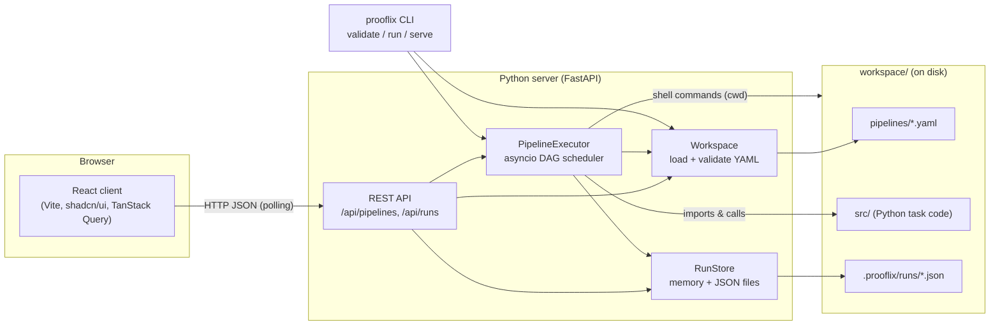
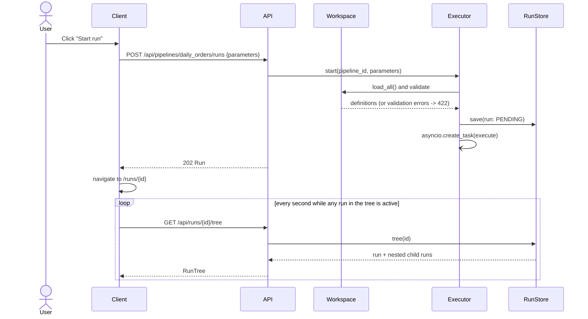

# Architecture

## Overview



* **Workspace**: a folder you own and can version-control. Each file in
  `pipelines/` is one pipeline; its file name is the pipeline id. Python task
  code lives in `src/`.
* **Server**: reads the workspace on every request (no cache, so edits made in
  an editor appear immediately), validates pipelines, executes runs on its
  asyncio event loop and keeps run history.
* **Client**: a single-page app that lists pipelines, shows their task graph,
  edits YAML, starts runs and follows them live, including nested sub-pipeline
  runs.
* **CLI**: the same engine without the web UI, for scripts and CI.

## Repository layout

```text
prooflix-core/
├── docs/                    design documents (this folder)
├── server/                  Python package "prooflix"
│   ├── pyproject.toml       dependencies (uv / pip)
│   ├── prooflix/
│   │   ├── main.py          FastAPI app factory
│   │   ├── cli.py           prooflix serve | validate | run
│   │   ├── config.py        settings from environment variables
│   │   ├── api/             HTTP routes and response schemas
│   │   ├── pipelines/       YAML models, workspace loading, validation, templating
│   │   ├── engine/          executor (DAG scheduling, sub-pipelines) and task runners
│   │   └── runs/            run records and their storage
│   └── tests/               pytest suite
├── client/                  React app
│   ├── components.json      shadcn/ui configuration
│   └── src/
│       ├── components/ui/   shadcn/ui primitives (button, card, table, tabs, ...)
│       ├── components/      app components (graph, editor, status badge, ...)
│       ├── pages/           one file per route
│       └── lib/             API client, types, utilities
└── workspace/               sample workspace
    ├── pipelines/           *.yaml pipeline definitions
    ├── src/jobs/            Python task code used by the samples
    └── data/                sample input (outputs go to data/output/, git-ignored)
```

## Request flow: starting a run from the UI



## Key design decisions

| Decision | Why |
|---|---|
| YAML files on disk are the source of truth | Pipelines can be reviewed in Git and edited in any editor, like Databricks Asset Bundles. |
| Pipeline id = file name | Stable reference for sub-pipeline calls; no separate registry to keep in sync. |
| Whole-workspace validation | A sub-pipeline call is only safe if the callee exists, accepts the parameters and does not recurse back. These checks need all files. |
| Sub-pipeline = child run | Each call gets its own run record, status, logs and outputs, viewable on its own and linked to its parent, like Databricks "Run Job" tasks. |
| asyncio executor in the server process | Simple to deploy, and enough for this milestone. The executor interface allows a remote/worker-based backend later. |
| Polling instead of WebSockets | Simple and robust. One request per second per open run page. |
| JSON files for run history | No database to install. `RunStore` is the only class to replace when moving to a database. |
