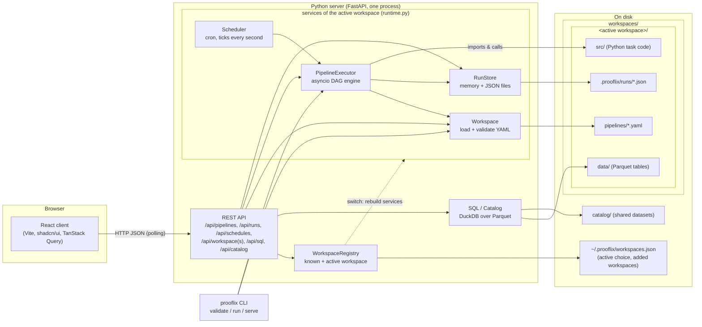
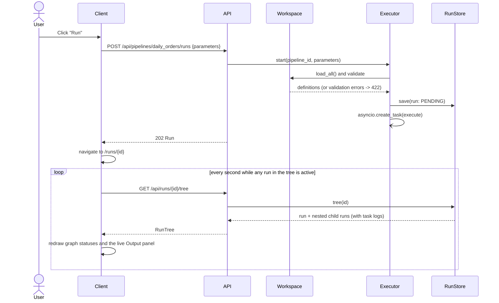
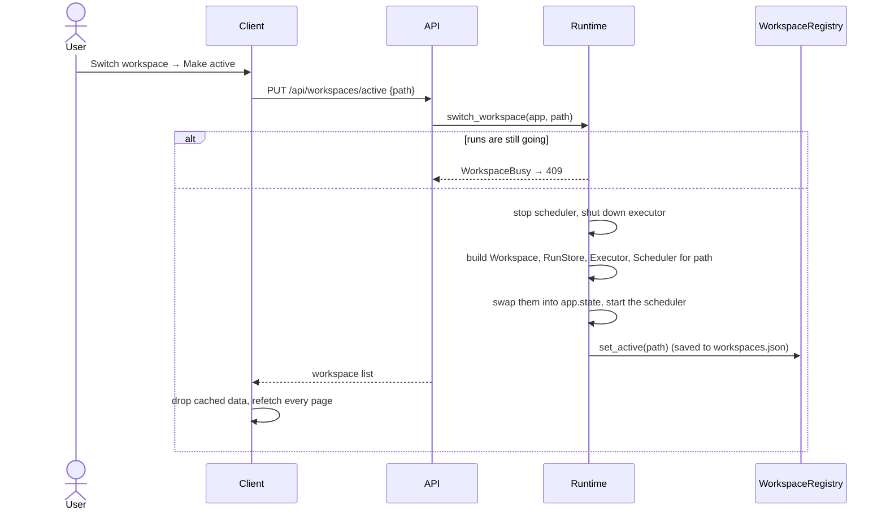

# Architecture

## Overview



* **Workspaces**: a workspace is a folder you own and can version-control, with
  `pipelines/` (one YAML file per pipeline; the file name is the pipeline id),
  `src/` (Python task code) and usually `data/`. Imported projects sit in it
  as sub-folders with their own `pipelines/` and `src/`. Workspaces live in the
  **workspaces folder** (`workspaces/` by default); exactly one is **active**,
  and the server runs pipelines, keeps run history and schedules from it.
* **Server**: one process. It reads the active workspace on every request (no
  cache, so edits made in an editor appear immediately), validates pipelines,
  executes runs on its asyncio event loop, starts scheduled runs, keeps run
  history and answers SQL queries over the data lake. It also serves the built
  client, so production needs nothing else.
* **Client**: a single-page app with four sections: **Pipelines** (list, graph,
  YAML, triggers, runs with live output), **SQL Editor**, **Catalog** and
  **Workspace** (files, import, create and switch workspaces).
* **CLI**: the same engine without the web UI, for scripts and CI. It uses the
  active workspace unless `--workspace` is given.

## Repository layout

```text
prooflix-core/
├── docs/                    design documents (this folder)
├── server/                  Python package "prooflix"
│   ├── pyproject.toml       dependencies (uv)
│   ├── prooflix/
│   │   ├── main.py          FastAPI app factory
│   │   ├── cli.py           prooflix serve | validate | run
│   │   ├── config.py        settings from environment variables
│   │   ├── workspaces.py    WorkspaceRegistry: the workspaces and the active one
│   │   ├── runtime.py       the active workspace's services, and switching
│   │   ├── api/             HTTP routes and response schemas
│   │   ├── pipelines/       YAML models, workspace loading, validation, templating, cron
│   │   ├── engine/          executor (DAG, sub-pipelines), task runners, scheduler
│   │   └── runs/            run records and their storage
│   └── tests/               pytest suite (and a sample workspace in fixtures/)
├── client/                  React app
│   ├── components.json      shadcn/ui configuration
│   └── src/
│       ├── components/ui/   shadcn/ui primitives (button, card, table, tabs, ...)
│       ├── components/      app components (graph, editor, run output, panels, ...)
│       ├── pages/           one file per route
│       └── lib/             API client, types, schedule and SQL helpers, utilities
├── deploy/
│   ├── helm/prooflix/       Helm chart (one pod, volume at /data)
│   └── terraform/           installs the chart with Terraform's Helm provider
├── Dockerfile               one image: built client + server
├── workspaces/              the workspaces, one folder each (git-ignored user content)
│   └── <workspace>/
│       ├── pipelines/       *.yaml pipeline definitions
│       ├── src/             Python task code
│       ├── data/            data lake files (Parquet), queryable in SQL
│       └── .prooflix/       run history (runs/) and removed files (trash/)
└── catalog/                 datasets outside any workspace (git-ignored)
```

## Request flow: starting a run from the UI



A scheduled run takes the same path from `Scheduler.tick()` to
`executor.start(..., trigger="schedule")`; the client finds it through the
runs list, which polls every second while any run is active.

## Switching the active workspace



## Key design decisions

| Decision | Why |
|---|---|
| YAML files on disk are the source of truth | Pipelines can be reviewed in Git and edited in any editor, like Databricks Asset Bundles. |
| Pipeline id = file name | Stable reference for sub-pipeline calls; no separate registry to keep in sync. |
| Whole-workspace validation | A sub-pipeline call is only safe if the callee exists, accepts the parameters and does not recurse back. These checks need all files. |
| Sub-pipeline = child run | Each call gets its own run record, status, logs and outputs, viewable on its own and linked to its parent, like Databricks "Run Job" tasks. |
| asyncio executor in the server process | Simple to deploy. The executor interface allows a remote/worker-based backend later. |
| One active workspace, switched in place | Pipelines, run history and schedules belong to one folder; switching rebuilds those services without a restart, and is refused while runs are going so no run is cut off. |
| Workspaces found by folder, first one active | Creating a workspace is just a folder with `pipelines/`; the active choice is saved so a new folder that sorts first doesn't take over. |
| Scheduler inside the server, ticking every second | No separate service; schedules (5-field cron, or 6 with seconds) are reloaded from YAML on each tick, so edits apply at once. No catch-up and no overlapping runs. |
| DuckDB over Parquet, per request | Tables are views over the files, so nothing is loaded up front; a fresh read-only connection per query keeps queries isolated. |
| Polling instead of WebSockets | Simple and robust: one request per second per open page while something runs. |
| JSON files for run history | No database to install. `RunStore` is the only class to replace when moving to a database. |
| One server process, one pod | Run history and the scheduler live in memory, so the Helm chart runs exactly one replica with its data on a volume. |
