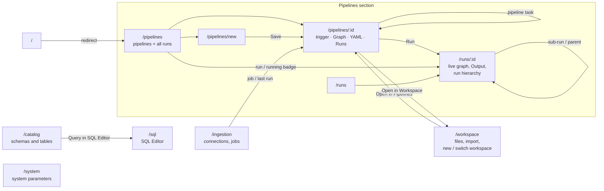
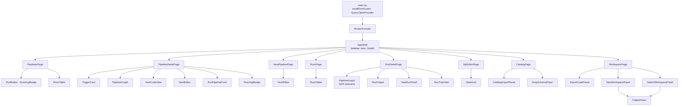
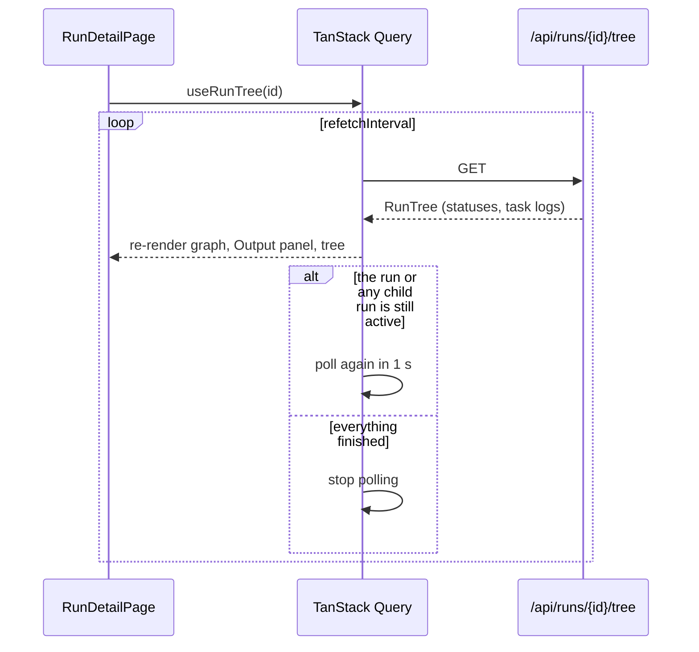

# Client

Prooflix has four single-page React apps: the **portal** (`products/portal/client`, at `/`),
**IngestIQ** (`products/ingestiq/client`, at `/ingestiq/`: Pipelines, Ingestion, Workspace,
SQL Editor, Catalog, Semantic model, ClickHouse, Alerts), **InsightIQ**
(`products/insightiq/client`, at `/insightiq/`: Object Model and Objects) and **Settings & Management**
(`products/settings/client`, at `/settings/`: System, Users, AI Assist settings; dev server
port 5176). The screens below are described
together; each belongs to the product that has its tab. Their look and frame come from the
shared package `packages/ui` (`@prooflix/ui`), which every product uses (principle 25):

| `@prooflix/ui` | What it holds |
|---|---|
| `styles.css` | theme tokens (light and dark), status colours, radius, base styles |
| `components/ui/*` | shadcn/ui primitives: alert, badge, button (with `loading`: a spinner in place of its icons, not clickable, while work goes on), card, input, label, separator, skeleton, table, tabs, textarea |
| `components/icon-tile`, `components/theme-toggle` | menu icon tiles; the light/dark switch (`setTheme`) |
| `layout/product-shell` | the frame of every product: top bar (logo, product name, actions), grouped side menu, theme switch |
| `lib/products` | the products (`PRODUCTS`): name, path, colour |
| `lib/utils`, `lib/api-error` | `cn`; `ApiError` and `errorMessages` |
| `auth/*` | sign-in for every product: `api` (status, sign in and out, password, `goToSignIn`), `login-page`, `user-menu`, `password-rules` |
| `layout/product-switcher` | the products menu in the top bar (the portal and the products the user can open) |
| `components/error-message` | a plain error alert for shared screens (sign-in) |
| `components/product-icon` | each product's gradient icon (portal tiles, switcher, top bar) |
| `components/resize-divider`, `lib/use-fill-height`, `lib/format`, `lib/dom-guard` | panel dividers, panels that fill the window, date and duration formats, the page-translation guard |
| `app/product-app` | the root route of IngestIQ, InsightIQ and Settings (a product with no tabs yet gets its frame and a coming soon note): sign-in check, `ProductShell` with the user's tabs, search, AI Assist panel, user menu, product switcher |
| `app/screens` | every product's tabs (`SCREENS`) and menu groups (`GROUPS`): one list for the menus, the Users tab and links between products |
| `app/sections` | the current product's tabs for shared screens (`useCurrentSection`, `useScreens` for links to any product, `useTabs`) |
| `app/command-palette` | Ctrl/Cmd+K: pages and common actions; each product adds its own commands (`lib/commands.ts`) |
| `app/error-alert`, `app/page-header`, `app/request` | errors offered to AI Assist, the page title with its tab tile, the API helper (`request`, `UNAUTHORIZED_EVENT`) |
| `ai-assist/*` | the AI Assist panel on every screen (`dock`), its icon and API (status, ask, settings fix) |
| `assets/*` | the Prooflix logos |

A product's `index.css` imports Tailwind, then `@prooflix/ui/styles.css`, and adds a
`@source` for the package. Add new shadcn components to the package (its
`components.json`), not to a product.

| Concern | Choice |
|---|---|
| Build tool | Vite 6 |
| Language | TypeScript (strict) |
| Framework | React 19 |
| UI components | shadcn/ui ("new-york" style) on Radix UI primitives |
| Styling | Tailwind CSS v4 with shadcn theme tokens (light and dark) |
| Routing | React Router 7 |
| Server state | TanStack Query 5 (caching, polling, mutations) |
| Icons | lucide-react |

## Folder structure

```text
client/
├── index.html               sets the theme before first paint; translate="no"
├── vite.config.ts           @ alias, /api proxy to 127.0.0.1:8000
└── src/
    ├── main.tsx             installs the DOM guard, QueryClientProvider + RouterProvider
    ├── router.tsx           route table
    ├── index.css            Tailwind and @prooflix/ui/styles.css imports
    ├── lib/
    │   ├── api.ts           fetch wrapper, ApiError, query and mutation hooks
    │   ├── types.ts         TypeScript mirror of the server schemas
    │   ├── commands.ts      the product's search commands (pipelines, jobs, runs)
    │   ├── schedule.ts      trigger presets <-> cron, cron descriptions
    │   ├── sql-names.ts     table names in the workspace
    │   ├── run-search.ts    search in the runs list
    │   └── utils.ts, use-pagination.ts
    ├── components/
    │   ├── pipeline-graph.tsx      DAG view (layered layout, SVG edges)
    │   ├── yaml-editor.tsx         YAML editor with Validate / Save
    │   ├── trigger-card.tsx        a pipeline's schedule: show, pause, edit (presets or cron)
    │   ├── run-button.tsx, run-pipeline-form.tsx   Run split button, Run with parameters panel
    │   ├── running-badge.tsx       "running" badge for pipelines with a run going
    │   ├── task-code-view.tsx      the code a selected task runs
    │   ├── runs-table.tsx          run list table
    │   ├── run-output.tsx          every task's printout, live
    │   ├── task-run-panel.tsx      one task's status, error and printout
    │   ├── run-tree-view.tsx       nested run → task → sub-run hierarchy
    │   ├── import-workspace-panel.tsx  upload a folder as a new workspace
    │   ├── new-workspace-panel.tsx, switch-workspace-panel.tsx, folder-picker.tsx
    │   └── ...                     status-badge, pager, ...
    └── pages/
        ├── pipelines-page.tsx        /pipelines (pipelines + all runs)
        ├── new-pipeline-page.tsx     /pipelines/new
        ├── pipeline-detail-page.tsx  /pipelines/:pipelineId
        ├── ingestion-page.tsx        /ingestion (database connections, ingestion jobs)
        ├── runs-page.tsx             /runs
        ├── run-detail-page.tsx       /runs/:runId
        ├── workspace-page.tsx        /workspace
        └── system-page.tsx           /system (system parameters)
```

InsightIQ (`products/insightiq/client/src`) is the Object Model, an ontology ([design](insightiq-ontology-design.md)). The
name people see is **Object Model**; routes, files, the tab id and the API keep `ontology`:

```text
src/
├── router.tsx                    ProductApp + the routes below (basename /insightiq)
├── lib/api.ts, types.ts          /api/ontology hooks and types
├── lib/commands.ts               search: New object type, each published type
│   pages/sets-page.tsx           /objects/sets, /objects/sets/:id: object sets and exports
├── components/ontology-ui.tsx    LayerBadge, TypeAvatar, CheckList, a first draft from a table
└── pages/
    ├── ontology-page.tsx         /ontology: the types as a graph or a list, with details
    ├── ontology-wizard-page.tsx  /ontology/new, /ontology/:name: the wizard
    └── objects-page.tsx          /objects (search), /objects/:type/:pk (an object and its links)
```

| Screen | What it shows |
|---|---|
| **Object Model** | The workspace's object types (published, and drafts with a dashed border) as a graph of cards and labelled link arrows, or a list. The side panel shows the selected type (source, row rules, key, title, properties, links, layer) with **Edit in the wizard**, **Open in Objects** and **Unpublish** / **Discard the draft**; for a type with Fast search, its index (ready, building with progress, out of date or failed, documents, Delta version) with **Rebuild** and **Cancel**; **Rebuild all fast search** in the header rebuilds every indexed type. **Suggested links** (dashed grey arrows marked ✦, and a list under the graph) come from columns named like another type's key (`Account.customer_id` → Customer's key `customer_id`: Customer **accounts** → Account, one to many); **Add link** puts it in the type's draft and opens the wizard on its Links step (`?step=links`) to check and publish it. |
| **Wizard** | Seven steps, each checked against the data as you type (red blocks **Next**, amber is a warning, blue is information), with a live preview object, and the draft saved at every **Next**. **Source**: any table of the catalog, filtered by layer (bronze, silver, gold); choosing one makes a full first draft (every column a property, a guessed key, title and sensitive columns). **Identity**: name, plural, description, key, title and the row rules (a filter, the newest row per key, with suggested ordering columns) and what they do (rows, distinct, duplicate and empty keys, before and after). **Properties**: names, descriptions, casts, units, searchable, sensitive; add or leave out columns. **Links**: suggested links as one-click chips; target, cardinality, names both ways, how it is stored (a property on each side, a link table, or computed with Spark SQL and a schedule), the properties to join on, and the match rate and cardinality found. **Actions**: controlled changes, each setting some properties (with optional choices) of one object, with who may run it and whether a reason is asked. **Access**: who sees the type and who sees its sensitive properties (admins, every signed-in user, or named users; bronze types start with admins only), with **View as user** on the preview. **Review & publish**: the changes against the published version, every check on the whole table, the **Fast search** switch (an OpenSearch index; a warning for tables over 10 million rows), **Publish**. Next, Save draft and Publish show a spinner while checks run or the draft saves. |
| **Objects** | One search box over every published type, results grouped by type (a type's facet shows up to 50); indexed types answer from their index (marked **fast search**, typo tolerant) and an autocomplete list opens under the box. An object page shows the title, key, layer and table, then **Properties** (with descriptions and units) and **Links** (both ways, with counts; choosing one lists the linked objects, which open their own page). Sensitive properties show as `••••` to everyone but admins and the people the type's access names; types a user may not see don't appear at all. The actions a user may run are buttons on the object page: a dialog asks for their values and a reason, and the changed properties show **edited** (who, when, which action). **History** lists the actions applied, newest first. On the Objects screens the **AI Assist** panel answers questions about objects (types an admin opened to AI Assist), with links to the objects it names and proposed actions as cards with **Apply** and **Dismiss**; sensitive values are never sent. |
| **Object sets** | `/objects/sets` (the **Object sets** switch on the Objects page): start from a type, add filters (is, contains, >, ≥, <, ≤, is one of, has a value, is empty), **Search around** to follow a link (up to 4 steps), **Run** to see the count after each step and page through the last step's objects. **Save** (private or **Shared**), **Export CSV** / **Export Parquet** (background, with progress, downloadable for 24 hours), **Open in SQL Editor**. |
| **Audit log** | `/ontology/audit`, for admins (button on the Object Model page when the database is set): publishing, actions, sensitive reads and *view as user*, filtered by event, type and user. |

It's built with `base: "/insightiq/"` and the router's `/insightiq` basename (dev server: port 5175).
Layer colours are theme tokens of `@prooflix/ui` (`--layer-bronze`, `--layer-silver`, `--layer-gold`). Links to another product's page are full
page loads (`productHref`); the SQL Editor also accepts a query as `/ingestiq/sql?sql=…` for them.

## Sections, routes and screens

**AI Assist on every screen.** When AI Assist is set up (or for an admin, who can set it up), every screen has an **AI Assist** panel on the right. It starts hidden. The top bar has an **Ask AI Assist…** box (next to the search box): Enter opens the panel and asks right away, on the run page about that run, elsewhere in the general chat (in the SQL Editor it appears under the SQL panel). The button beside the box shows and hides the panel, as does **›** in it, and the panel keeps its conversation while hidden; a red dot on the button means the screen shows an error. On small screens only the button shows. A divider on its left edge sets its width (drag, or focus it and use the arrow keys; double-click resets), remembered in the browser. It opens by itself when something fails: a failed run (run page), a failed query (SQL Editor), or any error message a screen shows (a save, import, test or delete that fails), once per error. On the run page and in the SQL Editor it holds their own AI Assist; on other screens it is a chat about Prooflix and the current screen, which offers to explain the error the screen shows. It goes step by step: first the offer to explain the screen's error, then the explanation, and only after an answer that says a setting change might fix the problem do users with the System tab get **Do you want AI Assist to fix it?** (not after plain questions or explanations). When an answer points to a screen ("take me to ClickHouse"), it has an **Open …** button for it (only screens the user has): it proposes System tab settings to change (shown as current → new, never secrets) and steps to do yourself; **Apply changes** saves the settings and **Restart server** applies them. Each question sends the question, the screen's name and that error (values that look like secrets masked) to Claude, never data. On wide screens (1280 px and up) it is a column beside the page; on narrower ones it slides over the page from the right.

Each product's sidebar is its one menu: IngestIQ's is grouped into **Build** (Pipelines, Ingestion, Workspace), **Data** (SQL Editor, Catalog, Semantic model, ClickHouse) and **Monitor** (Alerts), Settings & Management's into **Platform** (System, AI Assist) and **Access** (Users); a user sees the tabs an admin gave them, and the product switcher in the top bar moves between products. **Collapse** shrinks it to an icon rail (remembered in the browser). The top bar has the search box: **Ctrl+K / ⌘K** opens the command palette, which jumps to any page of the product and runs actions (dark mode, sign out), plus the product's own: in IngestIQ pipelines, ingestion jobs, tables (open in the Catalog or query in the SQL Editor) and recent runs (run a pipeline or a job, new pipeline, new query), in Settings add user, offering only what the user's tabs allow. On small screens the menu is a row of icons in the top bar. Each section remembers the last page you
opened in it.



| Screen | What it shows |
|---|---|
| **Pipelines** | Every pipeline of the active workspace: project, task count, sub-pipelines (links), trigger with next run, a valid / N errors badge, a **running** badge while a run is going, and Run (plus **Stop** while it is running). **Run** starts a run with the default parameters; the arrow on the right of Run opens a menu with **Run with parameters…**, a small panel with each parameter the pipeline declares in its YAML (in the workspace bundle; defaults filled in, editable) and its own **Run**. A pipeline with a required parameter that has no default opens that panel on Run. Below, all runs with search, split by a draggable divider; a failed run has a **Show error** link (its error on hover) that opens the run with the failed task's error and printout shown (`/runs/<id>?task=<key>`). |
| **Pipeline detail** | Header with a running badge and, while it runs, **Stop**; while a run of the pipeline is going, its **Output** panel (every task's printout, live) shows under the graph, and stays for the visit once the run ends; the **Trigger** card (schedule, next run, pause/resume, editor with presets or a cron of 5 or 6 fields and a preview of the next runs); a **Latest run** card that becomes **Running now** while a run is going; the same split **Run** button (the panel has one field per declared parameter: a text, number or date field, a checkbox or a list of choices by type, with the default, the description, a required mark and a preview check; the server checks every value again; `?run=1` opens it). Tabs: **Graph** (clicking a task shows the code it runs and its definition), **YAML** (Validate / Save, Cmd/Ctrl+S), **Runs** (also runs started as a sub-pipeline). |
| **Run detail** | The DAG colored by live task status, the run hierarchy, parameters and outputs (a divider between the two columns sets the side column's width, remembered in the browser). Below the graph, the **Output** panel: every task's printout in the order they ran (sub-pipeline tasks nested), updating live and following the newest line. Clicking a task shows only its printout. **Stop** while active, Run again when finished. When the run failed, the **AI Assist** panel on the right opens by itself: it offers to find out why the run failed and, once the user agrees, shows what went wrong, the task where it started and numbered steps to fix it (**›** or **Not now** hides it). Under the explanation, users with the Workspace tab get **Do you want AI Assist to fix it?**: **Fix it** shows the changes it proposes to the run's pipeline YAML and task code as diffs (with the pipeline checks' problems, if any), and **Apply changes** saves them (refused if a file changed meanwhile); **Discard** drops them. Nothing is saved or run before that; Run again checks the fix. A question box is always at the bottom of the card, before and after the explanation (**Enter** sends, **Shift+Enter** adds a line); the questions and answers stay until the page is left. |
| **Ingestion** | **Database connections**: name, type (with its icon), JDBC URL, user and a **Test** result; the form asks for the fields of the chosen type (Oracle: service name or SID; SQL Server: encryption options). **Ingestion jobs**: connection, tables, start date, trigger, last run, and **Run now** (**Stop** while running), edit, delete. The job editor lists the database's tables (with a filter); each ticked table opens to choose its columns, bronze table name and watermark column (or a full copy), the **key columns** (default: the primary key; rows already in bronze are overwritten by key, none: appended), and the trigger is the same editor as a pipeline's. Checkboxes select jobs for **Run selected**; **Run all** starts every job; **Ingest dates** (per job, or for the selected / all jobs) opens a panel to ingest the rows between two dates. The list is paged. |
| **SQL Editor** | Query tabs saved in the browser, completion of table and column names, results grid, Save SQL / Load SQL (`.sql` files), the **Schemas** list beside the editor (the same tree as the Catalog: catalog › schema › table › columns, then **Files and datasets**). In the **AI Assist** panel on the right (see AI Assist on every screen), a failed query opens it by itself and offers to explain the error and suggest a fix, which can be run or put in the editor. |
| **Catalog** | Catalogs, schemas and their tables with columns and row counts. The tree starts from the real catalogs: each one (such as `tenant1`) with its schemas (`bronze`, `silver`, `gold`) and their Delta tables (at their current version), so the path in the tree is the name SQL accepts (`tenant1.bronze.accounts`); a Delta table's data files are never listed as tables. Schemas outside a catalog (Parquet files in `data/` as `main`, projects' data, datasets in `catalog/`) come last, in a **Files and datasets** group. Import CSV/JSON as tables; Export as CSV or Parquet ZIP. **Drop schema** (on a schema's panel) asks whether to **hide it from the GUI** (its data stays in the data lake; **Hidden schemas** under the tree restores it) or **delete it permanently from the data lake** (admins only when users are on; type the schema name to confirm). The delete dialog warns that pipelines streaming from those tables fail until their streaming checkpoints are deleted too, since Prooflix doesn't delete checkpoints. Clicking a catalog (a tenant such as `tenant1`) opens its panel with its schemas and **Drop catalog**, which does the same for all of them at once. A draggable divider sets the tree's width (double-click resets it). |
| **Workspace** **Edit** opens a text file in an editor (Tab indents, Ctrl/Cmd+S saves); saving is refused if the file changed since you opened it, with **Reload the file** to start again. | The list of workspaces (the active one in bold, with each one's git branch and a mark on copies) above the active workspace's file tree; a file or folder viewer (the top folder has **Remove workspace**); **Import Workspace** (choose or drop a folder, then choose how to import it: **work on it in place**, where it is on the server, on the git branch checked out there (Prooflix finds the folder and fills in its path), or **copy it into `PROOFLIX_HOME/workspaces`** (the default); a link gives a server path instead, for a folder on another computer), **New workspace** (folder picker on the server, creates `pipelines/` and `src/`), **Switch workspace** (make another active, open another folder, remove from list). Removing a workspace only takes it off the list. |
| **ClickHouse** | The connection (where Prooflix writes, the address and read-only user for outside queries, an example query) and every gold table with a checkbox: rows, the ClickHouse table it becomes, rows already there, and its columns with their ClickHouse types. **Import to ClickHouse** copies the chosen tables and shows each one's result. |
| **System** | Every system parameter (`PROOFLIX_*`, see [server.md](server.md#configuration)): its value in use, default and source (edited here, environment or default). The pencil edits a value in place (a folder browser for folders, a date picker for the start date, a text box otherwise); the arrow removes the edited value. Edited values show **Restart to apply** until **Restart server** (in the header and in the banner) applies them. |
| **Semantic model** | Three tabs. **Model**: the entities on the left (with **Add entity**), metrics, and **Check against the catalog**; the editor on the right for the model's name, an entity (table, primary key, description; rows of dimensions, measures and joins, each from a column or a SQL expression) or the metrics (formulas with clickable `{entity.measure}` chips). **Save** writes `semantic/model.yaml`, **Revert** undoes unsaved changes. **YAML**: `semantic/model.yaml` as text, checked as you type (with the line of a syntax error) and saved exactly as written, comments included, once it is a valid model; it warns when the Model tab has unsaved changes. **Explore**: choose measures, metrics and dimensions, **Run**, see the SQL it wrote (open it in the SQL Editor) and the rows. |
| **Alerts** | Two tabs. **Alerts** (the default) lists the alerts raised; **Definitions** (`?tab=definitions`) holds the **alert rules** (message format with ready-made presets or a regular expression, a live "Try a log line" check showing the fields, severity, cooldown, all or chosen pipelines, all or chosen channels; pause, edit, delete), **Channels** (Email, Slack, Microsoft Teams, webhook, each with its icon and fields; **Test** sends a test alert) ; the Alerts tab is **Recent alerts** (paged, with each channel's delivery; delete one, the selected ones, or all). Admins, and users given the Alerts permission. |
| **AI Assist** (admins) | The Claude account AI Assist uses: on or off, the saved key as a masked row (`sk-ant-api03-••••••••abcd`, when it was saved, **Replace** and **Remove**), the model (each with its price per million input and output tokens, and a rough cost per answer) and the effort; **Test connection** checks the key without using tokens. |
| **Users** (admins) | Every user with their role, tabs and last sign-in; **Add user** and edit (role, the tabs they see as checkboxes, set a new password with a live check of the rules), disable / enable, delete. |
| **Login** | On the portal (`/`), the only sign-in page: user name and password, or, with no users yet, creating the first admin. After signing in, the portal's Home. The signed-in user is in every product's top bar, with **Change password** and **Sign out**; the menu shows only that user's tabs. |

## Component tree



## Data flow

All server access goes through `src/lib/api.ts`.

* `request()` wraps `fetch`, parses JSON and turns error responses into an
  `ApiError` with the server's `errors` list, which `ErrorAlert` displays.
* Query hooks: `usePipelines`, `usePipeline(id)`, `useTaskCode(id, task)`,
  `useRuns({pipeline, rootOnly})`, `useRunTree(id)`, `useWorkspaceTree`,
  `useWorkspaceFile(path)`, `useWorkspaces`, `useDirs(path)`, `useCatalog`,
  `useSqlTables`, `useHiddenSchemas`.
* Mutation hooks: `useStartRun`, `useCancelRun`, `useSavePipeline`,
  `useSetSchedule`, `useDeletePipeline`, `useImportWorkspace`,
  `useRemoveWorkspaceItem`, `useCreateWorkspace`, `useActivateWorkspace`,
  `useForgetWorkspace`, `useSqlQuery`, `useCatalogImport`, `useDropSchema`, `useDropCatalog`,
  `useRestoreSchema`. They invalidate the
  affected queries on success; switching the workspace drops every cached
  query, since all pages' data changes with it.

### Live updates by polling



`useRuns` polls every second while any listed run is active, otherwise every
5 seconds. The Pipelines list derives its **running** badges from it, so a
scheduled run shows up within a few seconds.

## The DAG view

`PipelineGraph` has no graph-library dependency:

1. Each task's **column** is the length of its longest dependency chain from a
   root task, so every edge points to the right.
2. Tasks within a column keep their YAML order.
3. Edges are SVG cubic Béziers from the right side of the source node to the
   left side of the target node.
4. Nodes are absolutely positioned HTML elements, so they can use the regular
   shadcn/Tailwind styles, icons and status colors.

The same component serves the definition view (no statuses) and the run view
(statuses from `TaskRun`), so the two screens always look alike.

## Page translation and extensions

Browser page translation and some extensions replace text nodes with their own
elements. React still holds the original nodes, so the next update that adds a
spinner next to such a text used to crash the page ("Failed to execute
'insertBefore' on 'Node'"). Two measures prevent this:

* `index.html` sets `translate="no"` and Google's `notranslate`, so Chrome does
  not offer to translate the app.
* `lib/dom-guard.ts`, installed before React renders, makes `insertBefore` and
  `removeChild` tolerate nodes that something else has moved. Icons that swap
  inside buttons also sit in a wrapper that never changes.

## shadcn/ui usage

* `components.json` holds the standard shadcn configuration, so more components
  can be added with `npx shadcn@latest add <component>` (for example `dialog`,
  `dropdown-menu`, `sonner`).
* Primitives in `components/ui/` are owned source code, not a package, and can
  be edited freely.
* Theme tokens (`--background`, `--primary`, ...) are CSS variables in
  `index.css`, with a `.dark` override. Status colors (`--status-running`,
  `--status-failed`, ...) are added as extra tokens and used as Tailwind
  classes such as `text-status-failed`.
* The theme follows the system setting until the user picks one with the
  sidebar toggle. The choice is saved in `localStorage`, as are per-viewer
  layout choices (panel sizes, SQL query tabs).

## Development

```bash
npm install        # once, at the repository root (npm workspaces)
cd products/ingestiq/client
npm run dev        # http://localhost:5173, proxies /api to the Python server
npm run build      # type-check and build to client/dist
```

IngestIQ is built with `base: "/ingestiq/"` and its router uses the `/ingestiq` basename.
When `client/dist` exists, the Python server serves it at
`http://127.0.0.1:8000/ingestiq/`, and the portal's build at `/`, so production needs only
one process. Old links at the root (`/pipelines/...`) are redirected to `/ingestiq/...`. The page is
served with `no-cache` and the hashed assets as immutable, so a reload always
picks up a new build.

## Portal (`products/portal/client`)

The enterprise portal, served at `/`. It's the only sign-in page: other products send a
signed-out user to `/` (`goToSignIn`). After signing in, the portal always shows **Home**: a
welcome and a tile per product from `PRODUCTS`, and below them, under **Administration**, a
**Settings & Management** link for users who can open it (admins, and users with the System tab). A product the user can open is a link. A product the server
doesn't serve yet shows **Coming soon**, and one the user has no tab of shows
**No access**. A user can open a product when they have one of its tabs (`visible_products`
from `/api/auth/status`). The portal has no side menu: it uses `ProductShell` with no items.

```bash
cd products/portal/client
npm run dev        # http://localhost:5174, proxies /api to the Python server
npm run build      # type-check and build to client/dist (served at / by the server)
```
