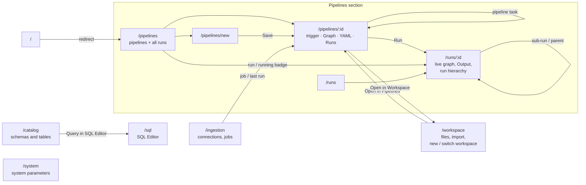
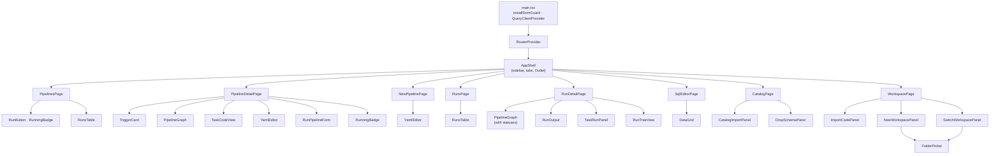
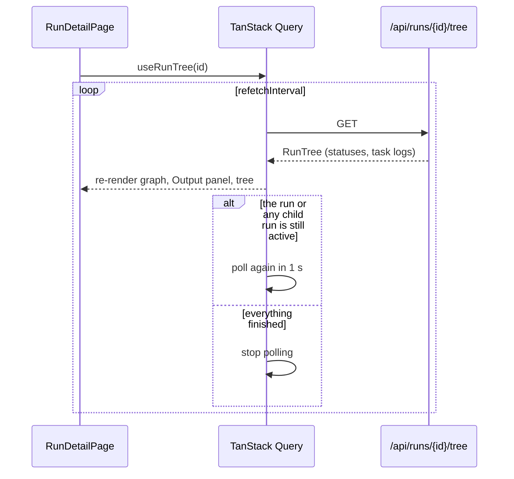

# Client

The client is a single-page React app in `client/`.

| Concern | Choice |
|---|---|
| Build tool | Vite 6 |
| Language | TypeScript (strict) |
| Framework | React 19 |
| UI components | shadcn/ui ("new-york" style) on Radix UI primitives |
| Styling | Tailwind CSS v4 with shadcn theme tokens (light and dark) |
| Routing | React Router 7 |
| Server state | TanStack Query 5 (caching, polling, mutations) |
| Icons | lucide-react |

## Folder structure

```text
client/
├── components.json          shadcn/ui config (aliases, style, base color)
├── index.html               sets the theme before first paint; translate="no"
├── vite.config.ts           @ alias, /api proxy to 127.0.0.1:8000
└── src/
    ├── main.tsx             installs the DOM guard, QueryClientProvider + RouterProvider
    ├── router.tsx           route table
    ├── index.css            Tailwind import, theme tokens, status colors
    ├── lib/
    │   ├── api.ts           fetch wrapper, ApiError, query and mutation hooks
    │   ├── types.ts         TypeScript mirror of the server schemas
    │   ├── tabs.ts          the six sections (sidebar + tabs) and their last page
    │   ├── schedule.ts      trigger presets <-> cron, cron descriptions
    │   ├── dom-guard.ts     keeps React working if page translation rewrites text
    │   ├── sql-completion.ts, sql-names.ts   SQL editor completion and table names
    │   ├── run-search.ts    search in the runs list
    │   └── utils.ts, use-pagination.ts, use-fill-height.ts
    ├── components/
    │   ├── ui/              shadcn/ui primitives: alert, badge, button, card, input,
    │   │                    label, separator, skeleton, table, tabs, textarea
    │   ├── layout/app-shell.tsx    sidebar, section tabs, theme toggle
    │   ├── pipeline-graph.tsx      DAG view (layered layout, SVG edges)
    │   ├── yaml-editor.tsx         YAML editor with Validate / Save
    │   ├── trigger-card.tsx        a pipeline's schedule: show, pause, edit (presets or cron)
    │   ├── run-button.tsx, run-pipeline-form.tsx   Run split button, Run with parameters panel
    │   ├── running-badge.tsx       "running" badge for pipelines with a run going
    │   ├── task-code-view.tsx      the code a selected task runs
    │   ├── runs-table.tsx          run list table
    │   ├── run-output.tsx          every task's printout, live
    │   ├── task-run-panel.tsx      one task's status, error and printout
    │   ├── run-tree-view.tsx       nested run → task → sub-run hierarchy
    │   ├── import-workspace-panel.tsx  upload a folder as a new workspace
    │   ├── new-workspace-panel.tsx, switch-workspace-panel.tsx, folder-picker.tsx
    │   ├── catalog-import-panel.tsx, data-grid.tsx   catalog import, result grids
    │   └── ...                     status-badge, page-header, pager, error-alert (with copy), ...
    └── pages/
        ├── pipelines-page.tsx        /pipelines (pipelines + all runs)
        ├── new-pipeline-page.tsx     /pipelines/new
        ├── pipeline-detail-page.tsx  /pipelines/:pipelineId
        ├── ingestion-page.tsx        /ingestion (database connections, ingestion jobs)
        ├── runs-page.tsx             /runs
        ├── run-detail-page.tsx       /runs/:runId
        ├── sql-editor-page.tsx       /sql
        ├── catalog-page.tsx          /catalog
        ├── workspace-page.tsx        /workspace
        ├── clickhouse-page.tsx       /clickhouse (copy gold tables to ClickHouse)
        └── system-page.tsx           /system (system parameters)
```

## Sections, routes and screens

The sidebar is the one menu, grouped into **Build** (Pipelines, Ingestion, Workspace), **Data** (SQL Editor, Catalog, Semantic model, ClickHouse) and **Admin** (Alerts, System, Users); a user sees the sections an admin gave them. **Collapse** shrinks it to an icon rail (remembered in the browser). The top bar has the search box: **Ctrl+K / ⌘K** opens the command palette, which jumps to any page, pipeline, ingestion job, table (open in the Catalog or query in the SQL Editor) or recent run, and runs actions (run a pipeline or an ingestion job, new pipeline, new query, add user, dark mode, sign out), offering only what the user's tabs allow. On small screens the menu is a row of icons in the top bar. Each section remembers the last page you
opened in it.



| Screen | What it shows |
|---|---|
| **Pipelines** | Every pipeline of the active workspace: project, task count, sub-pipelines (links), trigger with next run, a valid / N errors badge, a **running** badge while a run is going, and Run (plus **Stop** while it is running). **Run** starts a run with the default parameters; the arrow on the right of Run opens a menu with **Run with parameters…**, a small panel with each parameter the pipeline declares in its YAML (in the workspace bundle; defaults filled in, editable) and its own **Run**. A pipeline with a required parameter that has no default opens that panel on Run. Below, all runs with search, split by a draggable divider. |
| **Pipeline detail** | Header with a running badge and, while it runs, **Stop**; the **Trigger** card (schedule, next run, pause/resume, editor with presets or a cron of 5 or 6 fields and a preview of the next runs); a **Latest run** card that becomes **Running now** while a run is going; the same split **Run** button (the panel has one field per declared parameter: a text, number or date field, a checkbox or a list of choices by type, with the default, the description, a required mark and a preview check; the server checks every value again; `?run=1` opens it). The Graph tab's **Parameters** card lists each parameter's type and default. Tabs: **Graph** (clicking a task shows the code it runs and its definition), **YAML** (Validate / Save, Cmd/Ctrl+S), **Runs** (also runs started as a sub-pipeline). |
| **Run detail** | The DAG colored by live task status, the run hierarchy, parameters and outputs. Below the graph, the **Output** panel: every task's printout in the order they ran (sub-pipeline tasks nested), updating live and following the newest line. Clicking a task shows only its printout. **Stop** while active, Run again when finished. A failed run shows the **AI Assist** card at the top of the right column: it offers to find out why the run failed and, once the user agrees, shows what went wrong, the task where it started and numbered steps to fix it (**›** or **Not now** hides it). A question box is always at the bottom of the card, before and after the explanation (**Enter** sends, **Shift+Enter** adds a line); the questions and answers stay in the card until the page is left. |
| **Ingestion** | **Database connections**: name, type (with its icon), JDBC URL, user and a **Test** result; the form asks for the fields of the chosen type (Oracle: service name or SID; SQL Server: encryption options). **Ingestion jobs**: connection, tables, start date, trigger, last run, and **Run now** (**Stop** while running), edit, delete. The job editor lists the database's tables (with a filter); each ticked table opens to choose its columns, bronze table name and watermark column (or a full copy), the **key columns** (default: the primary key; rows already in bronze are overwritten by key, none: appended), and the trigger is the same editor as a pipeline's. Checkboxes select jobs for **Run selected**; **Run all** starts every job; **Ingest dates** (per job, or for the selected / all jobs) opens a panel to ingest the rows between two dates. The list is paged. |
| **SQL Editor** | Query tabs saved in the browser, completion of table and column names, results grid, Save SQL / Load SQL (`.sql` files), the **Schemas** list beside the editor (the same tree as the Catalog: catalog › schema › table › columns, then **Files and datasets**). The **AI Assist** panel on the right starts hidden; a small **‹** tab on the right edge opens it and **›** hides it. When a query fails it opens by itself and offers to explain the error and suggest a fix, which can be run or put in the editor. |
| **Catalog** | Catalogs, schemas and their tables with columns and row counts. The tree starts from the real catalogs: each one (such as `tenant1`) with its schemas (`bronze`, `silver`, `gold`) and their Delta tables (at their current version), so the path in the tree is the name SQL accepts (`tenant1.bronze.accounts`); a Delta table's data files are never listed as tables. Schemas outside a catalog (Parquet files in `data/` as `main`, projects' data, datasets in `catalog/`) come last, in a **Files and datasets** group. Import CSV/JSON as tables; Export as CSV or Parquet ZIP. **Drop schema** (on a schema's panel) asks whether to **hide it from the GUI** (its data stays in the data lake; **Hidden schemas** under the tree restores it) or **delete it permanently from the data lake** (admins only when users are on; type the schema name to confirm). Clicking a catalog (a tenant such as `tenant1`) opens its panel with its schemas and **Drop catalog**, which does the same for all of them at once. A draggable divider sets the tree's width (double-click resets it). |
| **Workspace** **Edit** opens a text file in an editor (Tab indents, Ctrl/Cmd+S saves); saving is refused if the file changed since you opened it, with **Reload the file** to start again. | The list of workspaces (the active one in bold, with each one's git branch and a mark on copies) above the active workspace's file tree; a file or folder viewer (the top folder has **Remove workspace**); **Import Workspace** (choose or drop a folder, then choose how to import it: **work on it in place**, where it is on the server, on the git branch checked out there (Prooflix finds the folder and fills in its path), or **copy it into `PROOFLIX_HOME/workspaces`** (the default); a link gives a server path instead, for a folder on another computer), **New workspace** (folder picker on the server, creates `pipelines/` and `src/`), **Switch workspace** (make another active, open another folder, remove from list). Removing a workspace only takes it off the list. |
| **ClickHouse** | The connection (where Prooflix writes, the address and read-only user for outside queries, an example query) and every gold table with a checkbox: rows, the ClickHouse table it becomes, rows already there, and its columns with their ClickHouse types. **Import to ClickHouse** copies the chosen tables and shows each one's result. |
| **System** | Every system parameter (`PROOFLIX_*`, see [server.md](server.md#configuration)): its value in use, default and source (edited here, environment or default). The pencil edits a value in place (a folder browser for folders, a date picker for the start date, a text box otherwise); the arrow removes the edited value. Edited values show **Restart to apply** until **Restart server** (in the header and in the banner) applies them. |
| **Semantic model** | Three tabs. **Model**: the entities on the left (with **Add entity**), metrics, and **Check against the catalog**; the editor on the right for the model's name, an entity (table, primary key, description; rows of dimensions, measures and joins, each from a column or a SQL expression) or the metrics (formulas with clickable `{entity.measure}` chips). **Save** writes `semantic/model.yaml`, **Revert** undoes unsaved changes. **YAML**: `semantic/model.yaml` as text, checked as you type (with the line of a syntax error) and saved exactly as written, comments included, once it is a valid model; it warns when the Model tab has unsaved changes. **Explore**: choose measures, metrics and dimensions, **Run**, see the SQL it wrote (open it in the SQL Editor) and the rows. |
| **Alerts** | Two tabs. **Alerts** (the default) lists the alerts raised; **Definitions** (`?tab=definitions`) holds the **alert rules** (message format with ready-made presets or a regular expression, a live "Try a log line" check showing the fields, severity, cooldown, all or chosen pipelines, all or chosen channels; pause, edit, delete), **Channels** (Email, Slack, Microsoft Teams, webhook, each with its icon and fields; **Test** sends a test alert) ; the Alerts tab is **Recent alerts** (paged, with each channel's delivery; delete one, the selected ones, or all). Admins, and users given the Alerts permission. |
| **AI Assist** (admins) | The Claude account AI Assist uses: on or off, the saved key as a masked row (`sk-ant-api03-••••••••abcd`, when it was saved, **Replace** and **Remove**), the model (each with its price per million input and output tokens, and a rough cost per answer) and the effort; **Test connection** checks the key without using tokens. |
| **Users** (admins) | Every user with their role, tabs and last sign-in; **Add user** and edit (role, the tabs they see as checkboxes, set a new password with a live check of the rules), disable / enable, delete. |
| **Login** | Shown when signed out: user name and password, or, with no users yet, creating the first admin. The signed-in user is in the top bar, with **Change password** and **Sign out**; the menu and tabs show only that user's tabs. |

## Component tree



## Data flow

All server access goes through `src/lib/api.ts`.

* `request()` wraps `fetch`, parses JSON and turns error responses into an
  `ApiError` with the server's `errors` list, which `ErrorAlert` displays.
* Query hooks: `usePipelines`, `usePipeline(id)`, `useTaskCode(id, task)`,
  `useRuns({pipeline, rootOnly})`, `useRunTree(id)`, `useWorkspaceTree`,
  `useWorkspaceFile(path)`, `useWorkspaces`, `useDirs(path)`, `useCatalog`,
  `useSqlTables`, `useHiddenSchemas`.
* Mutation hooks: `useStartRun`, `useCancelRun`, `useSavePipeline`,
  `useSetSchedule`, `useDeletePipeline`, `useImportWorkspace`,
  `useRemoveWorkspaceItem`, `useCreateWorkspace`, `useActivateWorkspace`,
  `useForgetWorkspace`, `useSqlQuery`, `useCatalogImport`, `useDropSchema`, `useDropCatalog`,
  `useRestoreSchema`. They invalidate the
  affected queries on success; switching the workspace drops every cached
  query, since all pages' data changes with it.

### Live updates by polling



`useRuns` polls every second while any listed run is active, otherwise every
5 seconds. The Pipelines list derives its **running** badges from it, so a
scheduled run shows up within a few seconds.

## The DAG view

`PipelineGraph` has no graph-library dependency:

1. Each task's **column** is the length of its longest dependency chain from a
   root task, so every edge points to the right.
2. Tasks within a column keep their YAML order.
3. Edges are SVG cubic Béziers from the right side of the source node to the
   left side of the target node.
4. Nodes are absolutely positioned HTML elements, so they can use the regular
   shadcn/Tailwind styles, icons and status colors.

The same component serves the definition view (no statuses) and the run view
(statuses from `TaskRun`), so the two screens always look alike.

## Page translation and extensions

Browser page translation and some extensions replace text nodes with their own
elements. React still holds the original nodes, so the next update that adds a
spinner next to such a text used to crash the page ("Failed to execute
'insertBefore' on 'Node'"). Two measures prevent this:

* `index.html` sets `translate="no"` and Google's `notranslate`, so Chrome does
  not offer to translate the app.
* `lib/dom-guard.ts`, installed before React renders, makes `insertBefore` and
  `removeChild` tolerate nodes that something else has moved. Icons that swap
  inside buttons also sit in a wrapper that never changes.

## shadcn/ui usage

* `components.json` holds the standard shadcn configuration, so more components
  can be added with `npx shadcn@latest add <component>` (for example `dialog`,
  `dropdown-menu`, `sonner`).
* Primitives in `components/ui/` are owned source code, not a package, and can
  be edited freely.
* Theme tokens (`--background`, `--primary`, ...) are CSS variables in
  `index.css`, with a `.dark` override. Status colors (`--status-running`,
  `--status-failed`, ...) are added as extra tokens and used as Tailwind
  classes such as `text-status-failed`.
* The theme follows the system setting until the user picks one with the
  sidebar toggle. The choice is saved in `localStorage`, as are per-viewer
  layout choices (panel sizes, SQL query tabs).

## Development

```bash
cd client
npm install
npm run dev        # http://localhost:5173, proxies /api to the Python server
npm run build      # type-check and build to client/dist
```

When `client/dist` exists, the Python server also serves the built client at
`http://127.0.0.1:8000/`, so production needs only one process. The page is
served with `no-cache` and the hashed assets as immutable, so a reload always
picks up a new build.
