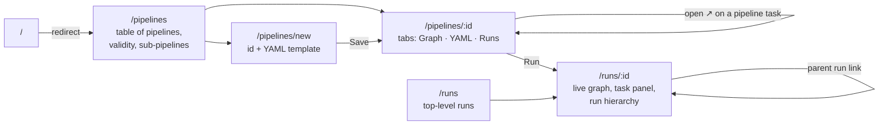
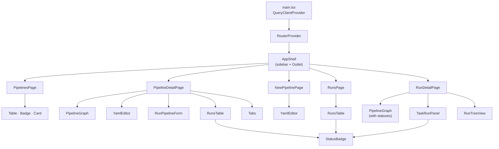
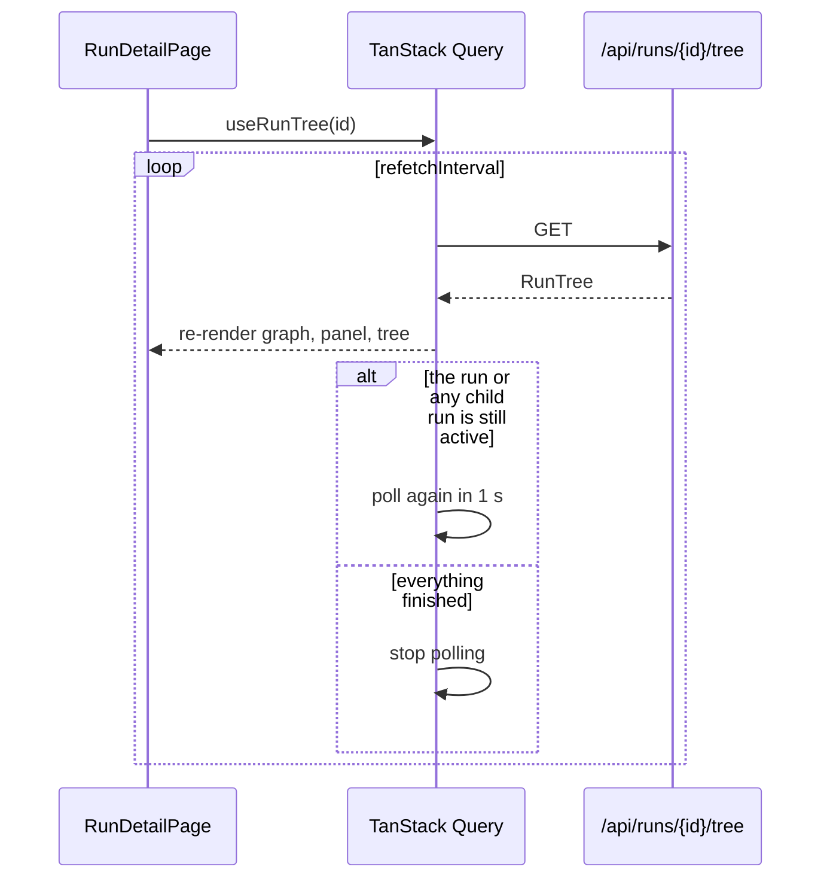

# Client

The client is a single-page React app in `client/`.

| Concern | Choice |
|---|---|
| Build tool | Vite 6 |
| Language | TypeScript (strict) |
| UI components | shadcn/ui ("new-york" style) on Radix UI primitives |
| Styling | Tailwind CSS v4 with shadcn theme tokens (light and dark) |
| Routing | React Router 7 |
| Server state | TanStack Query 5 (caching, polling, mutations) |
| Icons | lucide-react |

## Folder structure

```text
client/
├── components.json          shadcn/ui config (aliases, style, base color)
├── index.html               sets the theme before first paint
├── vite.config.ts           @ alias, /api proxy to 127.0.0.1:8000
└── src/
    ├── main.tsx             QueryClientProvider + RouterProvider
    ├── router.tsx           route table
    ├── index.css            Tailwind import, theme tokens, status colors
    ├── lib/
    │   ├── api.ts           fetch wrapper, ApiError, query and mutation hooks
    │   ├── types.ts         TypeScript mirror of the server schemas
    │   └── utils.ts         cn(), date and duration formatting
    ├── components/
    │   ├── ui/              shadcn/ui primitives: alert, badge, button, card, input,
    │   │                    label, separator, skeleton, table, tabs, textarea
    │   ├── layout/app-shell.tsx   sidebar, top bar on mobile, theme toggle
    │   ├── pipeline-graph.tsx     DAG view (layered layout, SVG edges)
    │   ├── yaml-editor.tsx        YAML editor with Validate / Save
    │   ├── run-pipeline-form.tsx  parameter form, starts a run
    │   ├── runs-table.tsx         run list table
    │   ├── run-tree-view.tsx      nested run → task → sub-run hierarchy
    │   ├── task-run-panel.tsx     one task's status, output, error, logs
    │   ├── status-badge.tsx       status → color + icon
    │   └── ...                    page-header, json-view, error-alert, task-type-icon
    └── pages/
        ├── pipelines-page.tsx        /pipelines
        ├── new-pipeline-page.tsx     /pipelines/new
        ├── pipeline-detail-page.tsx  /pipelines/:pipelineId
        ├── runs-page.tsx             /runs
        └── run-detail-page.tsx       /runs/:runId
```

## Routes and screens



| Screen | What it shows |
|---|---|
| **Pipelines** | Every YAML file, with task count, sub-pipelines it calls (as links) and a valid / N errors badge |
| **Pipeline detail: Graph** | DAG of tasks. Clicking a task shows its definition. The ↗ on a pipeline task opens the called pipeline. Side cards show parameters, *Calls* and *Used by*. |
| **Pipeline detail: YAML** | Editable YAML. **Validate** asks the server to check it against the whole workspace without saving. **Save** (or Cmd/Ctrl+S) writes the file. |
| **Pipeline detail: Runs** | Runs of this pipeline, including runs started as a sub-pipeline |
| **Run detail** | The same DAG colored by live task status, a panel with the selected task's output, error and logs, the run hierarchy tree, parameters and outputs. Cancel while active, Run again when finished. Child runs show a link back to their parent. |

## Component tree



## Data flow

All server access goes through `src/lib/api.ts`.

* `request()` wraps `fetch`, parses JSON and turns error responses into an
  `ApiError` with the server's `errors` list, which `ErrorAlert` displays.
* Query hooks: `usePipelines`, `usePipeline(id)`, `useRuns({pipeline, rootOnly})`,
  `useRunTree(id)`.
* Mutation hooks: `useStartRun`, `useCancelRun`, `useSavePipeline`,
  `useDeletePipeline`. They invalidate the affected queries on success.

### Live updates by polling



`useRuns` polls every second while any listed run is active, otherwise every
5 seconds.

## The DAG view

`PipelineGraph` has no graph-library dependency:

1. Each task's **column** is the length of its longest dependency chain from a
   root task, so every edge points to the right.
2. Tasks within a column keep their YAML order.
3. Edges are SVG cubic Béziers from the right side of the source node to the
   left side of the target node.
4. Nodes are absolutely positioned HTML elements, so they can use the regular
   shadcn/Tailwind styles, icons and status colors.

The same component serves the definition view (no statuses) and the run view
(statuses from `TaskRun`), so the two screens always look alike.

## shadcn/ui usage

* `components.json` holds the standard shadcn configuration, so more components
  can be added with `npx shadcn@latest add <component>` (for example `dialog`,
  `dropdown-menu`, `sonner`).
* Primitives in `components/ui/` are owned source code, not a package, and can
  be edited freely.
* Theme tokens (`--background`, `--primary`, ...) are CSS variables in
  `index.css`, with a `.dark` override. Status colors (`--status-running`,
  `--status-failed`, ...) are added as extra tokens and used as Tailwind
  classes such as `text-status-failed`.
* The theme follows the system setting until the user picks one with the
  sidebar toggle. The choice is saved in `localStorage`.

## Development

```bash
cd client
npm install
npm run dev        # http://localhost:5173, proxies /api to the Python server
npm run build      # type-check and build to client/dist
```

When `client/dist` exists, the Python server also serves the built client at
`http://127.0.0.1:8000/`, so production needs only one process.
