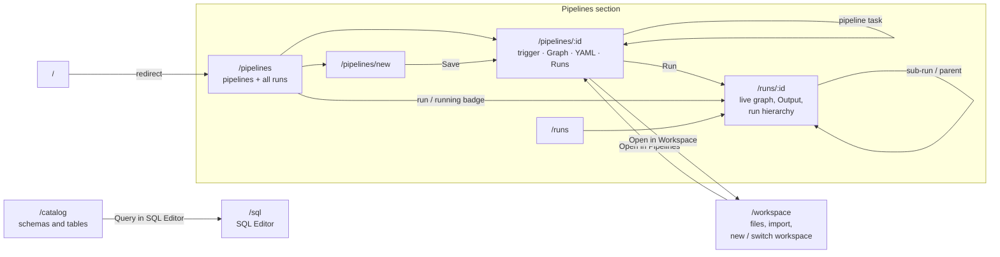
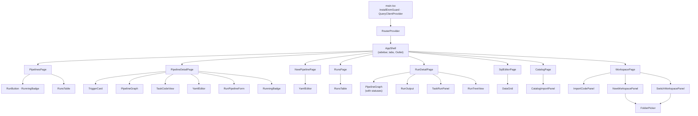
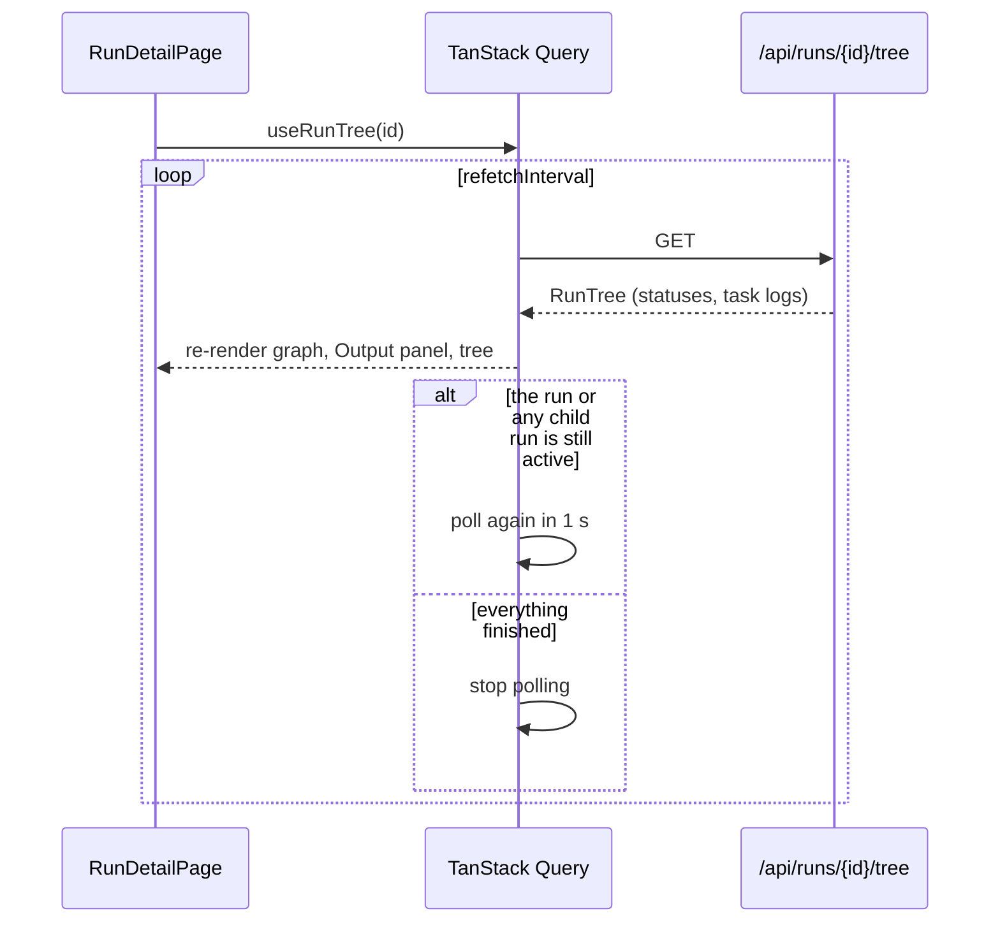

# Client

The client is a single-page React app in `client/`.

| Concern | Choice |
|---|---|
| Build tool | Vite 6 |
| Language | TypeScript (strict) |
| Framework | React 19 |
| UI components | shadcn/ui ("new-york" style) on Radix UI primitives |
| Styling | Tailwind CSS v4 with shadcn theme tokens (light and dark) |
| Routing | React Router 7 |
| Server state | TanStack Query 5 (caching, polling, mutations) |
| Icons | lucide-react |

## Folder structure

```text
client/
├── components.json          shadcn/ui config (aliases, style, base color)
├── index.html               sets the theme before first paint; translate="no"
├── vite.config.ts           @ alias, /api proxy to 127.0.0.1:8000
└── src/
    ├── main.tsx             installs the DOM guard, QueryClientProvider + RouterProvider
    ├── router.tsx           route table
    ├── index.css            Tailwind import, theme tokens, status colors
    ├── lib/
    │   ├── api.ts           fetch wrapper, ApiError, query and mutation hooks
    │   ├── types.ts         TypeScript mirror of the server schemas
    │   ├── tabs.ts          the four sections (sidebar + tabs) and their last page
    │   ├── schedule.ts      trigger presets <-> cron, cron descriptions
    │   ├── dom-guard.ts     keeps React working if page translation rewrites text
    │   ├── sql-completion.ts, sql-names.ts   SQL editor completion and table names
    │   ├── run-search.ts    search in the runs list
    │   └── utils.ts, use-pagination.ts, use-fill-height.ts
    ├── components/
    │   ├── ui/              shadcn/ui primitives: alert, badge, button, card, input,
    │   │                    label, separator, skeleton, table, tabs, textarea
    │   ├── layout/app-shell.tsx    sidebar, section tabs, theme toggle
    │   ├── pipeline-graph.tsx      DAG view (layered layout, SVG edges)
    │   ├── yaml-editor.tsx         YAML editor with Validate / Save
    │   ├── trigger-card.tsx        a pipeline's schedule: show, pause, edit (presets or cron)
    │   ├── run-button.tsx, run-pipeline-form.tsx   start a run (with parameters)
    │   ├── running-badge.tsx       "running" badge for pipelines with a run going
    │   ├── task-code-view.tsx      the code a selected task runs
    │   ├── runs-table.tsx          run list table
    │   ├── run-output.tsx          every task's printout, live
    │   ├── task-run-panel.tsx      one task's status, error and printout
    │   ├── run-tree-view.tsx       nested run → task → sub-run hierarchy
    │   ├── import-code-panel.tsx   upload a project folder into the workspace
    │   ├── new-workspace-panel.tsx, switch-workspace-panel.tsx, folder-picker.tsx
    │   ├── catalog-import-panel.tsx, data-grid.tsx   catalog import, result grids
    │   └── ...                     status-badge, page-header, pager, error-alert, ...
    └── pages/
        ├── pipelines-page.tsx        /pipelines (pipelines + all runs)
        ├── new-pipeline-page.tsx     /pipelines/new
        ├── pipeline-detail-page.tsx  /pipelines/:pipelineId
        ├── runs-page.tsx             /runs
        ├── run-detail-page.tsx       /runs/:runId
        ├── sql-editor-page.tsx       /sql
        ├── catalog-page.tsx          /catalog
        └── workspace-page.tsx        /workspace
```

## Sections, routes and screens

The sidebar and the tabs show four sections; each remembers the last page you
opened in it.



| Screen | What it shows |
|---|---|
| **Pipelines** | Every pipeline of the active workspace: project, task count, sub-pipelines (links), trigger with next run, a valid / N errors badge, a **running** badge while a run is going, and Run. Below, all runs with search, split by a draggable divider. |
| **Pipeline detail** | Header with a running badge; the **Trigger** card (schedule, next run, pause/resume, editor with presets or a cron of 5 or 6 fields and a preview of the next runs); a **Latest run** card that becomes **Running now** while a run is going. Tabs: **Graph** (clicking a task shows the code it runs and its definition), **YAML** (Validate / Save, Cmd/Ctrl+S), **Runs** (also runs started as a sub-pipeline). |
| **Run detail** | The DAG colored by live task status, the run hierarchy, parameters and outputs. Below the graph, the **Output** panel: every task's printout in the order they ran (sub-pipeline tasks nested), updating live and following the newest line. Clicking a task shows only its printout. Cancel while active, Run again when finished. |
| **SQL Editor** | Query tabs saved in the browser, completion of table and column names, results grid, Save SQL / Load SQL (`.sql` files), schema list beside the editor. |
| **Catalog** | Schemas (a project's `data/` or a folder in `catalog/`) and their tables with columns and row counts; Import CSV/JSON as tables; Export as CSV or Parquet ZIP. |
| **Workspace** | The list of workspaces (the active one in bold) above the active workspace's file tree; a file or folder viewer; **Import code**, **New workspace** (folder picker on the server, creates `pipelines/` and `src/`), **Switch workspace** (make another active, open another folder, remove from list). |

## Component tree



## Data flow

All server access goes through `src/lib/api.ts`.

* `request()` wraps `fetch`, parses JSON and turns error responses into an
  `ApiError` with the server's `errors` list, which `ErrorAlert` displays.
* Query hooks: `usePipelines`, `usePipeline(id)`, `useTaskCode(id, task)`,
  `useRuns({pipeline, rootOnly})`, `useRunTree(id)`, `useWorkspaceTree`,
  `useWorkspaceFile(path)`, `useWorkspaces`, `useDirs(path)`, `useCatalog`,
  `useSqlTables`.
* Mutation hooks: `useStartRun`, `useCancelRun`, `useSavePipeline`,
  `useSetSchedule`, `useDeletePipeline`, `useImportWorkspace`,
  `useRemoveWorkspaceItem`, `useCreateWorkspace`, `useActivateWorkspace`,
  `useForgetWorkspace`, `useSqlQuery`, `useCatalogImport`. They invalidate the
  affected queries on success; switching the workspace drops every cached
  query, since all pages' data changes with it.

### Live updates by polling



`useRuns` polls every second while any listed run is active, otherwise every
5 seconds. The Pipelines list derives its **running** badges from it, so a
scheduled run shows up within a few seconds.

## The DAG view

`PipelineGraph` has no graph-library dependency:

1. Each task's **column** is the length of its longest dependency chain from a
   root task, so every edge points to the right.
2. Tasks within a column keep their YAML order.
3. Edges are SVG cubic Béziers from the right side of the source node to the
   left side of the target node.
4. Nodes are absolutely positioned HTML elements, so they can use the regular
   shadcn/Tailwind styles, icons and status colors.

The same component serves the definition view (no statuses) and the run view
(statuses from `TaskRun`), so the two screens always look alike.

## Page translation and extensions

Browser page translation and some extensions replace text nodes with their own
elements. React still holds the original nodes, so the next update that adds a
spinner next to such a text used to crash the page ("Failed to execute
'insertBefore' on 'Node'"). Two measures prevent this:

* `index.html` sets `translate="no"` and Google's `notranslate`, so Chrome does
  not offer to translate the app.
* `lib/dom-guard.ts`, installed before React renders, makes `insertBefore` and
  `removeChild` tolerate nodes that something else has moved. Icons that swap
  inside buttons also sit in a wrapper that never changes.

## shadcn/ui usage

* `components.json` holds the standard shadcn configuration, so more components
  can be added with `npx shadcn@latest add <component>` (for example `dialog`,
  `dropdown-menu`, `sonner`).
* Primitives in `components/ui/` are owned source code, not a package, and can
  be edited freely.
* Theme tokens (`--background`, `--primary`, ...) are CSS variables in
  `index.css`, with a `.dark` override. Status colors (`--status-running`,
  `--status-failed`, ...) are added as extra tokens and used as Tailwind
  classes such as `text-status-failed`.
* The theme follows the system setting until the user picks one with the
  sidebar toggle. The choice is saved in `localStorage`, as are per-viewer
  layout choices (panel sizes, SQL query tabs).

## Development

```bash
cd client
npm install
npm run dev        # http://localhost:5173, proxies /api to the Python server
npm run build      # type-check and build to client/dist
```

When `client/dist` exists, the Python server also serves the built client at
`http://127.0.0.1:8000/`, so production needs only one process. The page is
served with `no-cache` and the hashed assets as immutable, so a reload always
picks up a new build.
