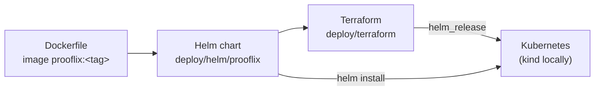
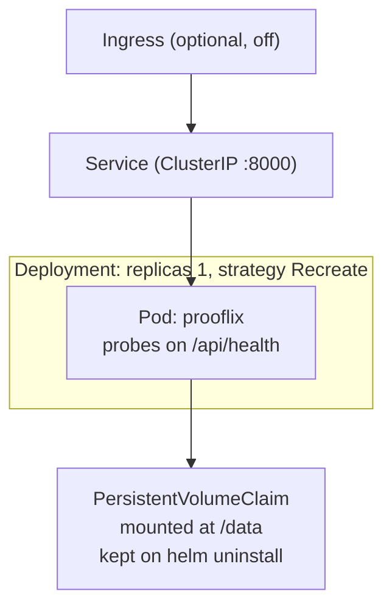

# Deployment

Prooflix ships as **one container**: the FastAPI server, which also serves the
built React client, on port 8000. The repository has three layers on top of
each other:



## Image (`Dockerfile`)

* **Stage 1** (Node 20) builds `client/dist`.
* **Stage 2** (Python 3.12 + uv) installs the server from `uv.lock` and copies
  the client build next to it. The repository layout is kept under `/app`
  (`/app/server`, `/app/client/dist`), because the server finds the client
  relative to the repository root.
* Runs as a non-root user (uid 10001) with
  `prooflix serve --host 0.0.0.0 --port 8000`.
* Data lives under `/data`: `PROOFLIX_WORKSPACES=/data/workspaces`,
  `PROOFLIX_CATALOG=/data/catalog` and `PROOFLIX_HOME=/data/.prooflix` (the
  workspace list and the active workspace).

## Helm chart (`deploy/helm/prooflix`)



| Choice | Why |
|---|---|
| Exactly one replica, `Recreate` | Run history is held in memory and the scheduler runs in the server process; two pods would run every schedule twice. The volume is `ReadWriteOnce`. |
| Persistent volume at `/data` | Workspaces (pipelines, code, run history), the catalog and the active choice survive restarts. The claim has `helm.sh/resource-policy: keep`. |
| Startup, liveness and readiness probes on `/api/health` | The pod only gets traffic once the server answers. |
| `terminationGracePeriodSeconds: 60` | Running tasks get time to finish their current step on shutdown. |
| Ingress off by default | There is no login; reach it with `kubectl port-forward` or an internal Ingress. |

Main values: `image.repository/tag/pullPolicy`, `prooflix.scheduler`,
`prooflix.maxDepth`, `prooflix.extraEnv`, `persistence.size/storageClass/existingClaim`,
`ingress.*`, `resources`.

## Terraform (`deploy/terraform`)

Installs the chart with the `hashicorp/helm` provider (v3), so the chart stays
the single description of the Kubernetes resources. Variables cover the kube
context (default `kind-kind`), namespace, image, scheduler, volume size,
storage class and `extra_values` for any other chart value. A hash of the
chart's files is put on the pod, so editing a template rolls the pod on the
next `apply`. State is local (`terraform.tfstate`, git-ignored); the provider
lock file is committed.

## Local cluster workflow (kind)

```bash
docker build -t prooflix:dev .
kind load docker-image prooflix:dev
cd deploy/terraform && terraform init && terraform apply
kubectl port-forward svc/prooflix 8000:8000
```

After a code change, rebuild and load the image, then
`kubectl rollout restart deploy/prooflix`. `terraform destroy` removes the
release but keeps the volume.

## Limits of this setup

* Pipeline tasks run inside the server container, so libraries an imported
  project needs must be in the image.
* Only folders under `/data` survive a pod restart; the folder picker can
  browse the whole container filesystem.
* No authentication: anyone who can reach the server can import and run code.
