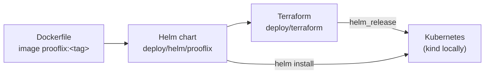
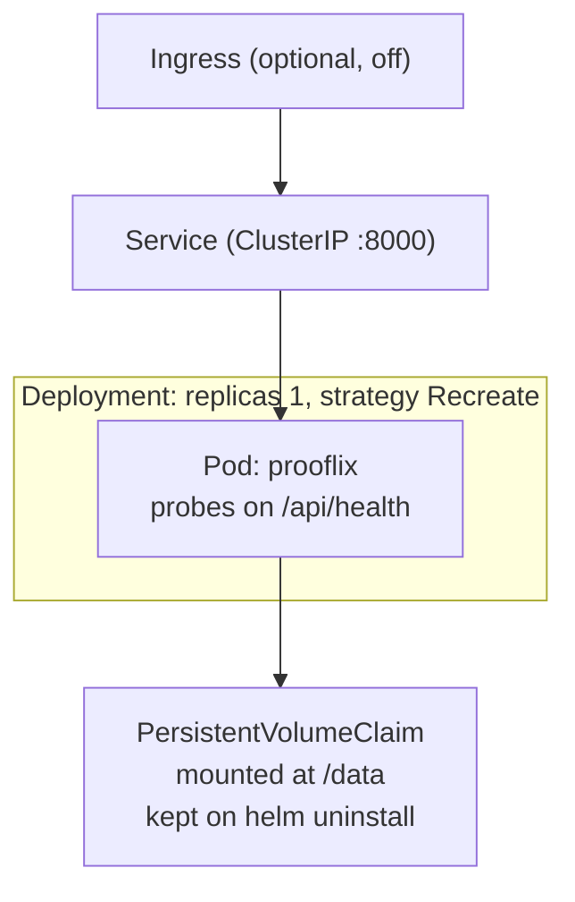
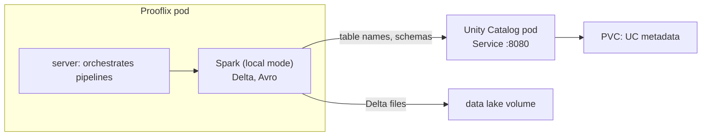

# Deployment

Prooflix ships as **one container**: the FastAPI server, which also serves the
built React client, on port 8000. The repository has three layers on top of
each other:



## Image (`Dockerfile`)

* **Stage 1** (Node 20) builds `client/dist`.
* **Stage 2** (Python 3.12 + uv) installs the server from `uv.lock`, with the
  `spark` extra (PySpark), and copies the client build next to it.
* **Spark**: Java 17 is copied in from `eclipse-temurin:17-jre` (OpenJDK, GPLv2
  with the Classpath Exception, free for commercial use; `JAVA_HOME=/opt/java/openjdk`).
  The Spark packages pipelines use (Delta Lake 4.3.1, the Unity Catalog connector
  0.7.0, Avro; build argument `SPARK_PACKAGES`) are fetched at build time into
  `/opt/spark-ivy` (`PROOFLIX_SPARK_IVY`, `PROOFLIX_SPARK_PACKAGES`), so pods
  start without downloading anything. Rebuild the image now and then for Java
  security updates. The repository layout is kept under `/app`
  (`/app/server`, `/app/client/dist`), because the server finds the client
  relative to the repository root.
* Runs as a non-root user (uid 10001) with
  `prooflix serve --host 0.0.0.0 --port 8000`.
* Data lives under `/data`: `PROOFLIX_WORKSPACES=/data/workspaces`,
  `PROOFLIX_CATALOG=/data/catalog` and `PROOFLIX_HOME=/data/.prooflix` (the
  workspace list and the active workspace). The data lake defaults to each
  workspace's `data/` on that volume; `dataLake` moves it (see below).

## Helm chart (`deploy/helm/prooflix`)



| Choice | Why |
|---|---|
| Exactly one replica, `Recreate` | Run history is held in memory and the scheduler runs in the server process; two pods would run every schedule twice. The volume is `ReadWriteOnce`. |
| Persistent volume at `/data` | Workspaces (pipelines, code, run history), the catalog and the active choice survive restarts. The claim has `helm.sh/resource-policy: keep`. |
| Startup, liveness and readiness probes on `/api/health` | The pod only gets traffic once the server answers. |
| `terminationGracePeriodSeconds: 60` | Running tasks get time to finish their current step on shutdown. |
| Ingress off by default | There is no login; reach it with `kubectl port-forward` or an internal Ingress. |

Main values: `image.repository/tag/pullPolicy`, `prooflix.scheduler`,
`prooflix.maxDepth`, `prooflix.startDate`, `prooflix.extraEnv`,
`persistence.size/storageClass/existingClaim`, `sourceData.*`, `dataLake.*`,
`ingress.*`, `resources`.

**System parameters in the pod.** The chart sets these environment variables;
the rest keep their defaults (see [server.md](server.md#configuration)):

| Variable | Set from |
|---|---|
| `PROOFLIX_WORKSPACES` | `/data/workspaces` (fixed) |
| `PROOFLIX_CATALOG` | `/data/catalog` (fixed) |
| `PROOFLIX_HOME` | `/data/.prooflix` (fixed, on the volume) |
| `PROOFLIX_SCHEDULER` | `prooflix.scheduler` |
| `PROOFLIX_MAX_DEPTH` | `prooflix.maxDepth` |
| `PROOFLIX_START_DATE` | `prooflix.startDate`, when not empty |
| `PROOFLIX_SOURCE_DATA` | `sourceData.path`, or its volume's mount path |
| `PROOFLIX_DATA_LAKE` | `dataLake.path`, or its volume's mount path |

A value edited in the **System** tab is saved in `PROOFLIX_HOME` on the volume
and wins over the chart's value, so it survives pod restarts and upgrades;
remove it in the System tab to go back to the chart's value. **Restart server**
applies edits without restarting the pod (`PROOFLIX_CORS` needs a
`kubectl rollout restart`).

**Source data** (`sourceData`): the raw files pipelines read. Every workspace's
`source/` becomes a link to it (`PROOFLIX_SOURCE_DATA`). Same keys as `dataLake`
below (mounted at `/source-data`), plus `sourceData.volume.readOnly` (default
`true`: Prooflix never writes there). Terraform: `source_data_*` variables.

**Data lake** (`dataLake`): what pipelines build, `data/<catalog>/<schema>/<table>/`
(bronze, gold) and their checkpoints; the catalog and the SQL editor read it.
Every workspace's `data/` becomes a link to it (`PROOFLIX_DATA_LAKE`). A
workspace can still choose its own folders in the web client.

| Value | Default | Meaning |
|---|---|---|
| `dataLake.path` | `""` | Folder in the pod. Empty: `dataLake.volume.mountPath` when the volume is enabled, else each workspace's own `data/` |
| `dataLake.volume.enabled` | `false` | Mount a separate volume for the data lake (data lakes outgrow the main volume) |
| `dataLake.volume.mountPath` | `/datalake` | Where it is mounted |
| `dataLake.volume.size` / `storageClass` / `accessModes` | `100Gi` / cluster default / `ReadWriteOnce` | For the PVC the chart creates (kept on `helm uninstall`) |
| `dataLake.volume.existingClaim` | `""` | Mount a PVC you created, e.g. one bound to existing data |

For example `helm install prooflix deploy/helm/prooflix --set sourceData.volume.enabled=true --set sourceData.volume.existingClaim=raw-files --set dataLake.volume.enabled=true --set dataLake.volume.size=500Gi`.
Terraform has matching `data_lake_*` variables.

**Spark and Unity Catalog.** Spark is the execution engine inside pipeline
tasks; Prooflix still orchestrates. Tasks share one Spark session in local mode
inside the Prooflix pod, so the pod's memory limit has to cover the Spark driver.
The chart also runs the open-source Unity Catalog server, where the Delta tables
are registered (`tenant1.bronze.*`, `tenant1.silver.*`, `tenant1.gold.*`); their
files stay in the data lake folder.



| Value | Default | Meaning |
|---|---|---|
| `spark.master` | `local[*]` | `PROOFLIX_SPARK_MASTER` |
| `spark.driverMemory` | `4g` | `PROOFLIX_SPARK_DRIVER_MEMORY`; keep it below `resources.limits.memory` (default `6Gi`) |
| `spark.conf` | `{}` | More Spark settings (`PROOFLIX_SPARK_CONF`, JSON) |
| `unityCatalog.enabled` | `true` | Run the Unity Catalog server (`unitycatalog/unitycatalog:v0.7.0`) in the release |
| `unityCatalog.uri` | `""` | Use a Unity Catalog server elsewhere instead (`PROOFLIX_UC_URI`; default: this release's) |
| `unityCatalog.token` | `""` | `PROOFLIX_UC_TOKEN`, when that server needs one |
| `unityCatalog.catalog` | `tenant1` | The tenant catalog (`PROOFLIX_UC_CATALOG`) |
| `unityCatalog.persistence.*` | `1Gi` volume | The server's metadata database (kept on `helm uninstall`) |

Terraform: `spark_driver_memory`, `unity_catalog_enabled`, `unity_catalog_uri`,
`unity_catalog_catalog`.

## Terraform (`deploy/terraform`)

Installs the chart with the `hashicorp/helm` provider (v3), so the chart stays
the single description of the Kubernetes resources. Variables cover the kube
context (default `kind-kind`), namespace, image, scheduler, volume size,
storage class and `extra_values` for any other chart value. A hash of the
chart's files is put on the pod, so editing a template rolls the pod on the
next `apply`. State is local (`terraform.tfstate`, git-ignored); the provider
lock file is committed.

## Local cluster workflow (kind)

```bash
docker build -t prooflix:dev .
kind load docker-image prooflix:dev
cd deploy/terraform && terraform init && terraform apply
kubectl port-forward svc/prooflix 8000:8000
```

After a code change, rebuild and load the image, then
`kubectl rollout restart deploy/prooflix`. `terraform destroy` removes the
release but keeps the volume.

## Limits of this setup

* Pipeline tasks run inside the server container, so libraries an imported
  project needs must be in the image.
* Spark runs in local mode in the Prooflix pod: it scales with the pod's CPU and
  memory, not across nodes.
* Only folders under `/data` survive a pod restart; the folder picker can
  browse the whole container filesystem.
* No authentication: anyone who can reach the server can import and run code.
