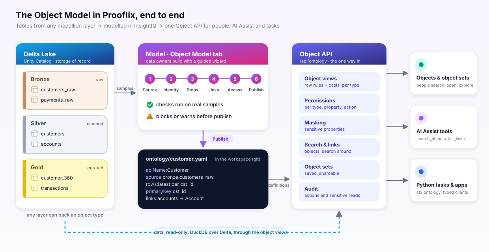
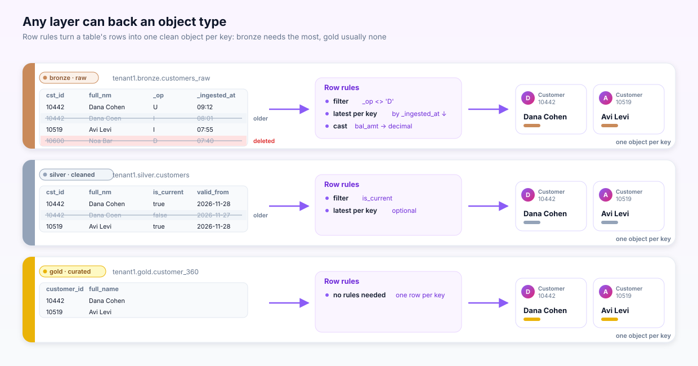
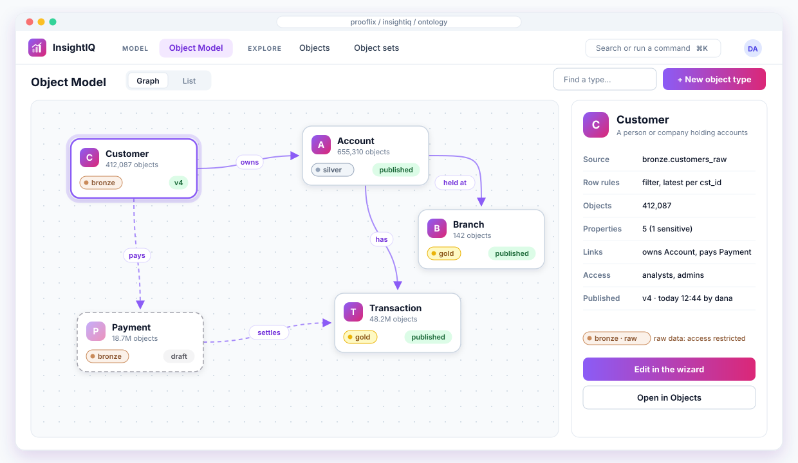
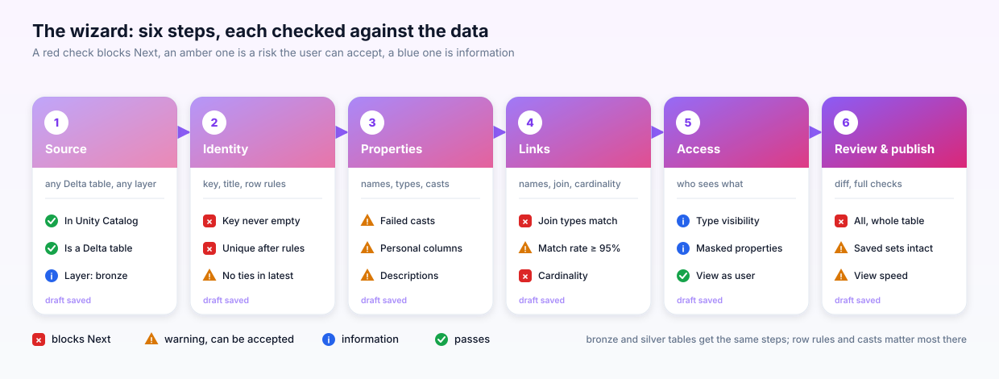
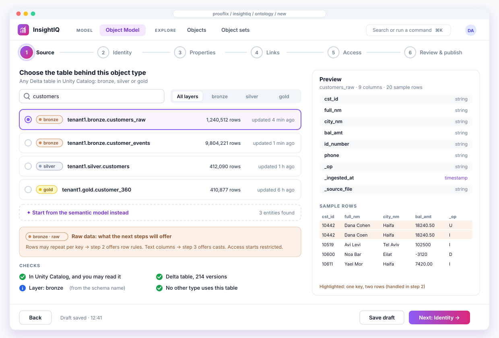
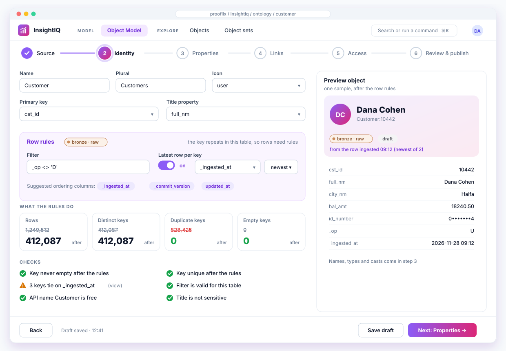
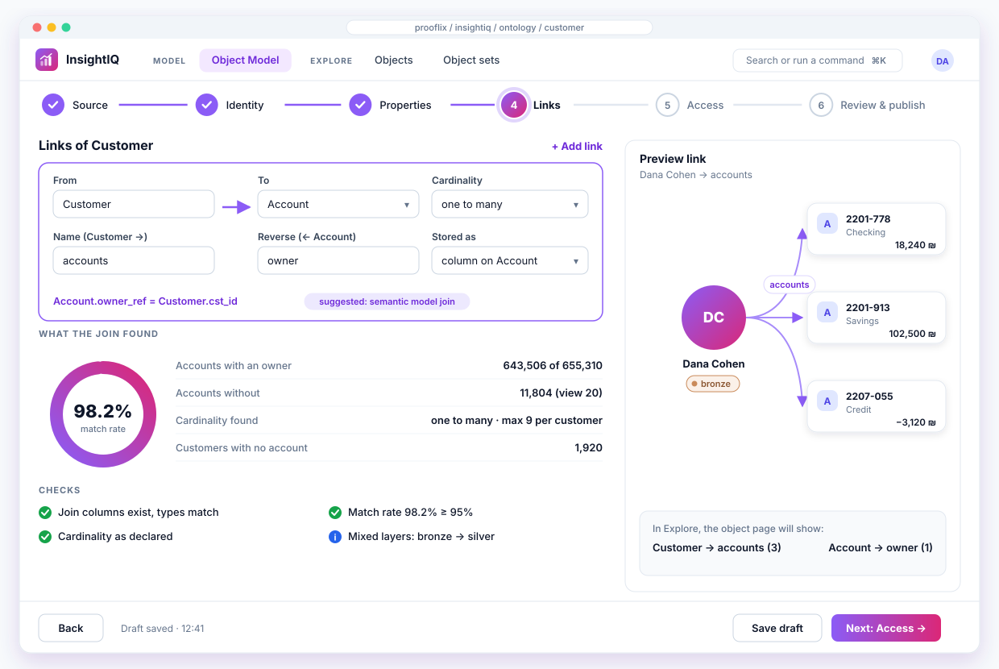
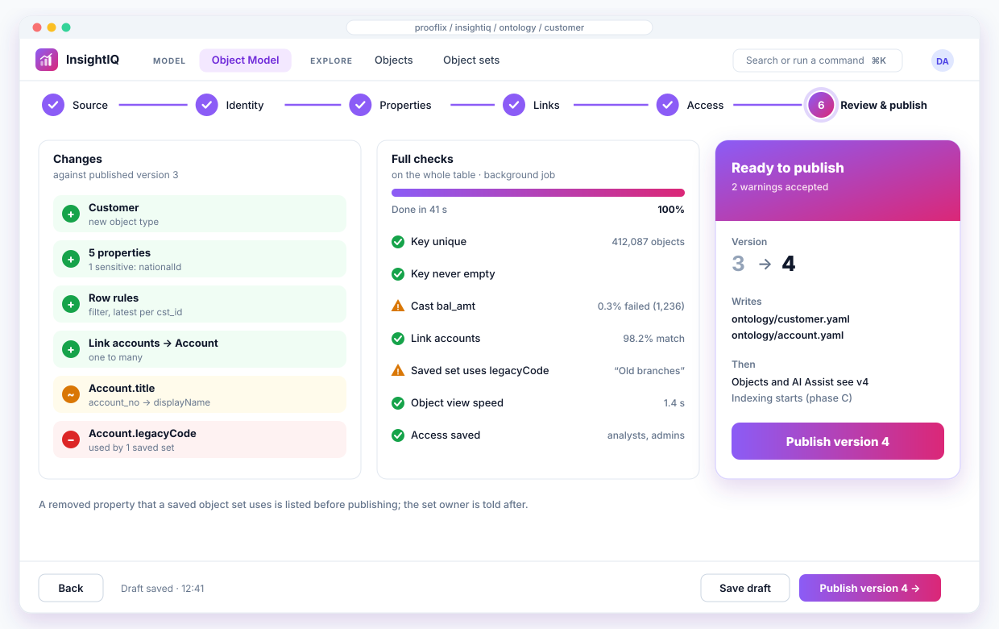
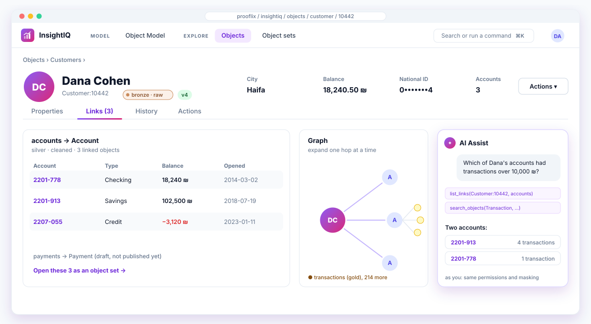

# InsightIQ Object Model: product design

Status: **phase A built** (see [section 12](#12-phase-a-what-is-built)); phases B to E are proposed. This document describes the first product
in InsightIQ: an ontology that turns lake tables into business **objects** (a *Customer*, an
*Account*, a *Transaction*), the **links** between them and the **actions** allowed on them,
built step by step in a guided GUI and used by people, Python tasks and AI Assist.

**Name.** People see this product as the **Object Model** (the tab, page titles and messages).
It is an ontology in the Palantir sense, and the code keeps that name: the `ontology` tab id, the
`/api/ontology` routes, the workspace's `ontology/` folder and `ontology.py`.

The images are in [images/insightiq-ontology/](images/insightiq-ontology/), drawn by its `draw.py`.



## 1. Why an ontology

An object is a row plus its meaning: names and descriptions written by people, a stable
identity, named relationships, permissions and allowed actions. Defining that once, and
using it everywhere, gives:

- **People** a search box and object pages, not table names and joins.
- **AI Assist** tools with meaning written down (`search_objects`, `list_links`), so it doesn't
  guess joins, units or status codes, and it can't read past the user's permissions.
- **Applications and tasks** one definition of "customer", which survives table renames.

Free-form analytics stays in the SQL Editor and the semantic model. The ontology is for
finding, navigating and acting on individual things.

## 2. Terms

| Term | Meaning | Example |
|---|---|---|
| Object type | A kind of thing, backed by one Delta table | *Customer*, from `tenant1.bronze.customers_raw` |
| Object | One instance of a type, identified by its primary key | `Customer:10442` |
| Property | A named, typed, described field mapped to a column | *Full name* ← `full_nm` |
| Row rules | How the source table's rows become objects: a filter, and *latest row per key* | keep the newest `_ingested_at` per `cst_id` |
| Link type | A named relationship between two types | *Customer* **owns** *Account* (one to many) |
| Action type | A controlled change with parameters, rules and permissions | *Flag account* |
| Object set | A saved query: a type, filters and "search around" steps | Customers in Haifa → accounts → transactions > 10,000 |
| Source layer | Where the table sits in the medallion: bronze, silver or gold | shown as a badge on every type |

## 3. Sources from any layer

An object type can be backed by **any Delta table registered in Unity Catalog, in bronze,
silver or gold**. Gold is often the cleanest choice, but not the only valid one:

- **Bronze** has the freshest data and every raw field, so it suits operational objects
  (an incoming payment, a raw device event) and early modelling, before a gold table exists.
- **Silver** is cleaned and conformed, which is often all an object needs.
- **Gold** is business-ready: one row per entity and checked keys.

The difference between layers is not *whether* a table can be used, but *what the wizard
must check and offer* to turn its rows into clean objects.



### 3.1 What changes with the layer

| | Bronze | Silver | Gold |
|---|---|---|---|
| Rows per key | Often many (every change appended) | Usually one, sometimes history | One |
| Typical row rule | **Latest per key** by an ordering column, and a filter for deletes (`_op <> 'D'`) | Optional latest per key, filter on `is_current` | None |
| Column types | Often strings: the wizard offers **casts** and shows how many values fail | Mostly typed | Typed |
| Key check | Uniqueness checked **after** the row rules | Same | Same, expected to pass at once |
| Default access | **Restricted** to the owner and admins until step ⑤ is saved (raw data may hold unmasked personal fields) | Workspace default | Workspace default |
| Badge on the object page | `bronze · raw` (amber) | `silver · cleaned` (slate) | `gold · curated` (yellow) |
| Query cost | Highest (row rules run on every read until it is indexed) | Medium | Lowest |

The layer is read from the table's schema name (`bronze`, `silver`, `gold`), or from a table
property `prooflix.layer` when the schema name doesn't say. A table with no layer shows as
`unclassified` and is treated like bronze (all checks, restricted by default).

### 3.2 Row rules

Row rules are the one thing that makes bronze and silver tables usable as objects. They are
declarative, chosen from the GUI, and compiled by the server into one read-only query, the
**object view**:

```sql
SELECT cst_id, full_nm, TRY_CAST(bal_amt AS DECIMAL(18,2)) AS balance, ...
FROM delta_scan('…/bronze/customers_raw')
WHERE _op <> 'D'                                   -- filter
QUALIFY row_number() OVER (PARTITION BY cst_id ORDER BY _ingested_at DESC) = 1  -- latest per key
```

- **Filter**: one boolean expression on the source's columns, validated like the semantic
  model's expressions (one expression, only the source's columns, run with no rows first).
- **Latest per key**: an ordering column (a timestamp, a sequence or a version) and a
  direction. Ties are reported as a problem, because they make an object change at random.
- **Casts**: per property, with `TRY_CAST`, and the number of values that fail is shown.

Every read of the type (search, object page, links, AI tools, indexing in later phases) goes
through the object view, so an object looks the same everywhere.

### 3.3 Mixing layers

Links may connect types from different layers (a bronze *Payment* to a gold *Account*).
The Review step shows a **mixed layers** note on such links, since the two sides can be
refreshed at different times and a link may briefly point to an object that doesn't exist
yet.

### 3.4 When a bronze-backed type gets heavy

If the Review step measures a slow object view (a large table with latest per key), it
suggests building a silver or gold table for it in IngestIQ and switching the source later.
Switching the source keeps the type's API name, properties and links, so object sets, links
and AI tools don't change.

## 4. Where it lives in InsightIQ

| Group | Tab | Who | Purpose |
|---|---|---|---|
| **Model** | Object Model | Data owners, admins | The object model graph, the guided wizard, publishing |
| **Explore** | Objects | Everyone given the tab | Search, object pages with properties, links, history and actions |
| | Object sets | Everyone given the tab | Saved filters and "search around" steps, with export |

They are added to `SCREENS` and `GROUPS` (`packages/ui/src/app/screens.ts`) for `insightiq`,
and to `PRODUCT_TABS` and `TAB_PATHS` in `auth.py`, which makes InsightIQ's portal tile
active instead of "coming soon".

## 5. The Model flow, step by step

### 5.1 The Object Model tab: the graph

The tab opens on a graph of the workspace's ontology: object types as cards (icon, name,
number of objects, layer badge, draft or published), links as labelled arrows. A list view
shows the same with a search box. **New object type** starts the wizard; clicking a type opens
it in the wizard at the step you click.



### 5.2 The wizard

Six steps along the top. Each step has a form on the left, a **live preview** of a real
sample object on the right, and **checks** under the form that run against the data. A
failing check that would make objects wrong **blocks** Next; one that is only a risk is a
**warning** the user can accept. The draft is saved after every step, so the user can stop
and come back, and two people can't overwrite each other's draft (the server answers `409`,
as the semantic model does).



#### ① Source

Choose the table from the catalog, in any layer. The picker shows bronze, silver and gold
side by side with their badges, row counts and last update. The right side shows the columns
and 20 sample rows. **Start from the semantic model** creates draft types from its entities,
with their tables and joins already filled in.



| Check | Severity |
|---|---|
| The table exists in Unity Catalog and the user may read it | block |
| The table is a Delta table | block |
| The table's layer, and what it means for the next steps (shown as a note) | info |
| Another type already uses this table | warning |

#### ② Identity and row rules

Name, plural, description, icon and colour; the **primary key**; the **title property**;
and, for tables that need them, the **row rules** (filter, latest per key). The step shows
the numbers that matter, before and after the rules: rows, distinct keys, duplicates, empty
keys.



| Check | Severity |
|---|---|
| The key is never empty, after the row rules | block |
| The key is unique, after the row rules (shows how many duplicates and examples) | block |
| With latest per key: no ties on the ordering column | warning |
| The filter is one valid expression on this table's columns | block |
| The API name is valid and free in this workspace | block |
| The title property is not marked sensitive | warning |

When the key isn't unique on a bronze or silver table, the step offers **Use latest per key**
with the likely ordering columns (`_ingested_at`, `updated_at`, `_commit_version`) already
suggested.

#### ③ Properties

A grid with one row per column: include or not, display name, API name, description, type
(with a **cast** for string columns), unit, **searchable** and **sensitive**. **Suggest with
AI Assist** proposes names, descriptions, types and the sensitive flag from column names and
sample values; each proposal is accepted or edited, as with **Apply changes** today. This is
where the meaning AI Assist relies on later is written down.

| Check | Severity |
|---|---|
| Each cast: how many values fail (shown per column), over 1% | warning |
| Column names that look personal (`id_number`, `phone`, `email`) not marked sensitive | warning |
| Every property has a description | warning |
| Unique API names | block |

#### ④ Links

**Add link**: the target type, the names in both directions (*owns* / *owned by*), and how
it is stored: a column in this table, a column in the other one, or a join table. The server
runs the join on the two object views and shows the match rate, the cardinality it found and
the rows that don't match. Suggestions come from column names that look like keys and from
the semantic model's joins. (Built in phase A: a type whose column is named like another type's key
gets a suggested link, shown dashed on the graph, in a list under it and as chips in this step; one
click adds it to a draft. Suggestions from the semantic model's joins are not built yet.)



| Check | Severity |
|---|---|
| The join columns exist and have compatible types | block |
| Match rate below 95% (the threshold is a system parameter) | warning |
| The cardinality found contradicts the declared one | block |
| The two sides are in different layers | info |

#### ⑤ Access

Who can see the type, each sensitive property and, from phase B, each action, using the
existing roles and users. **View as user** shows the preview object exactly as a chosen user
would see it, with masked properties. Bronze-backed types start restricted to the owner and
admins (section 3.1) until this step is saved.

#### ⑥ Review and publish

A diff against the published version (types, properties, links and rules added, changed or
removed), every check run again on the **whole** table in a background job with progress,
and the object view's measured speed. **Publish** writes the definition, records the version
and, from phase C, starts indexing.



| Check | Severity |
|---|---|
| Any blocking check from steps ① to ⑤, on the whole table | block |
| A removed property or link is used by a saved object set | warning (lists them) |
| The object view takes more than 2 seconds on the whole table | warning, with the suggestion in section 3.4 |

## 6. The definition file

Following principle 4, the GUI configures and the output is a readable file in the
workspace, one per object type, in `ontology/` (next to `semantic/model.yaml`). Drafts are
kept in `ontology/.drafts/`. A file can also be edited by hand and is validated the same way.

```yaml
# ontology/customer.yaml (written by InsightIQ's Object Model tab)
api_name: Customer
plural: Customers
description: A person or company that holds accounts at the bank.
source:
  table: tenant1.bronze.customers
  layer: bronze # read from the schema when saved
  rows:
    filter: "_op <> 'D'"
    latest_by: _ingested_at # the newest row per key (latest_desc: false for the oldest)
primary_key: customer_id
title: full_name
properties:
  - {api_name: customer_id, column: cst_id, description: The customer's number}
  - {api_name: full_name, column: full_nm, searchable: true, description: The full name as registered}
  - {api_name: balance, column: bal_amt, type: decimal, unit: ILS} # type: a cast (TRY_CAST)
  - {api_name: national_id, column: id_number, sensitive: true}
links:
  - api_name: accounts
    target: Account
    cardinality: one-to-many # or many-to-one, one-to-one
    reverse: owner # its name seen from Account
    from_property: customer_id
    to_property: owner_id # a property of Account
```

Type names start with a capital letter (`Customer`, `BankAccount` → `bank_account.yaml`);
property and link names with a small letter. Casts: `string`, `integer`, `number`, `decimal`,
`boolean`, `date`, `timestamp`. Access per type (`access:`) comes with phase B.

## 7. The Explore flow

- **Objects**: one search box across all types the user may see, results grouped by type,
  facets on the left (type, layer, searchable properties).
- **Object page**: the title, type, layer badge and key properties at the top; tabs for
  **Properties**, **Links** (a list, and a graph that expands one hop at a time), **History**
  (the object at earlier Delta versions, and edits from phase B) and **Actions**.
- **Object sets**: start from a type, add filters, add **Search around** steps, see the count
  after each step; save, share, export to CSV, or open as SQL in IngestIQ's SQL Editor (a
  `productHref` link with `?sql=`).



## 8. AI Assist

On InsightIQ's screens AI Assist gets ontology tools generated from the published
definitions: `search_objects`, `get_object`, `list_links`, `aggregate` and, from phase B,
`propose_action`.

- Tools call the Object API **as the signed-in user**: the same permissions and masking.
- Answers link to object pages.
- Actions are only proposed; a person applies them.
- Text found in objects is data, never instructions.
- Each call is limited in rows and time, and audited.

## 9. Server

The routes as built are listed in [server.md](server.md); this was the plan. New routes in IngestIQ's server under `/api/ontology`, each in `TAB_PATHS` (principle 8):
building and publishing belong to the `ontology` tab, reading objects to `objects` and
`object-sets`.

| Method | Path | Purpose |
|---|---|---|
| GET | `/api/ontology/types` | Published types (and drafts for the `ontology` tab) |
| GET, PUT, DELETE | `/api/ontology/drafts/{type}` | A draft, saved per step (`409` when it changed meanwhile) |
| POST | `/api/ontology/drafts/{type}/check` | Run one step's checks on a sample, or all on the whole table (a background job) |
| POST | `/api/ontology/drafts/{type}/preview` | Sample objects through the draft's object view, as a chosen user |
| POST | `/api/ontology/drafts/{type}/suggest` | AI Assist proposals for properties and links |
| POST | `/api/ontology/drafts/{type}/publish` | Validate, write `ontology/<type>.yaml`, record the version |
| GET | `/api/ontology/objects/{type}/{pk}` | One object, masked for the user |
| POST | `/api/ontology/objects/{type}/search` | Filters, text, sort, paging |
| GET | `/api/ontology/objects/{type}/{pk}/links/{link}` | Linked objects, paged |
| POST | `/api/ontology/object-sets/run` | Run a set (filters and search-around steps) |

- Reads go through DuckDB over Delta, read-only, off the event loop (principle 20), with row
  and time limits. **Principle 3 lists the readers DuckDB may serve; this change adds the
  ontology to that list.**
- Row rules, casts and filters are compiled by the server; the client never sends SQL.
- Tests cover every route, signed in and out, as for the semantic model.

## 10. Phases

| Phase | Delivers | New infrastructure |
|---|---|---|
| A (**built**) | The tabs, the wizard (steps ① to ④ and ⑥), object views over any layer, object search and object pages, YAML definitions | none |
| B | Access (⑤) with masking, actions with an edits table, audit; the definitions also loaded into PostgreSQL | PostgreSQL |
| C | Indexing from Delta Change Data Feed through the object view, fast search and autocomplete | OpenSearch |
| D | Object sets, links precomputed by Spark, background exports | none |
| E | AI Assist tools, and an MCP server over the Object API | none |

Phase A is useful on its own: one type from any layer, searchable and with object pages.

## 11. Open questions

1. Should admins be able to forbid a layer for objects (for example "no bronze in
   production"), as a system parameter?
2. Drafts in `ontology/.drafts/` are files in the workspace repository: should they be
   ignored by git, or committed so drafts are shared between machines?
3. Should a bronze-backed type be allowed into AI Assist's tools before its access step is
   saved, or only after?
4. The match-rate threshold for links (95%): one system parameter, or per link?

## 12. Phase A: what is built

- **Server**: `prooflix/ontology.py` (definitions, files, object views, checks, search) and
  `prooflix/api/ontology.py` (routes, listed in [server.md](server.md)); access through the new
  `ontology` and `objects` tabs (`TAB_PATHS`, `PRODUCT_TABS`), so InsightIQ's portal tile opens.
- **Client**: InsightIQ's **Object Model** tab (graph or list, details, the wizard) and **Objects**
  tab (search, object pages with links both ways). See [client.md](client.md).
- **Tests**: `tests/test_ontology.py` (a bronze table with repeated keys, a deleted row and text
  amounts; a silver table; links, masking and access).
- Measured on the local banking data (65 million customers, 117 million accounts, 398 million
  transactions): the identity checks take about 1.5 s, a link check about 4 s, a search about 2 s
  and an object page under 0.5 s.

Different from the design above, for now:

| Design | Phase A |
|---|---|
| ⑤ Access, with *View as user* | Not built: sensitive properties are masked for everyone but admins; bronze types are not restricted |
| *Suggest with AI Assist* in ③ and ④ | Not built (the wizard says *later phase*) |
| The full checks of ⑥ as a background job | Run in the request (each query is stopped after 30 seconds) |
| *Delta table* blocks | A warning: Parquet tables of the catalog work too, without history |
| Links stored as a join table | Only a property on each side |
| Object sets tab, History and Actions tabs on an object page | Phases B and D |
| `409` for a type name already in use | Publishing a new type over a published one answers `409`; the draft itself may share the name |

