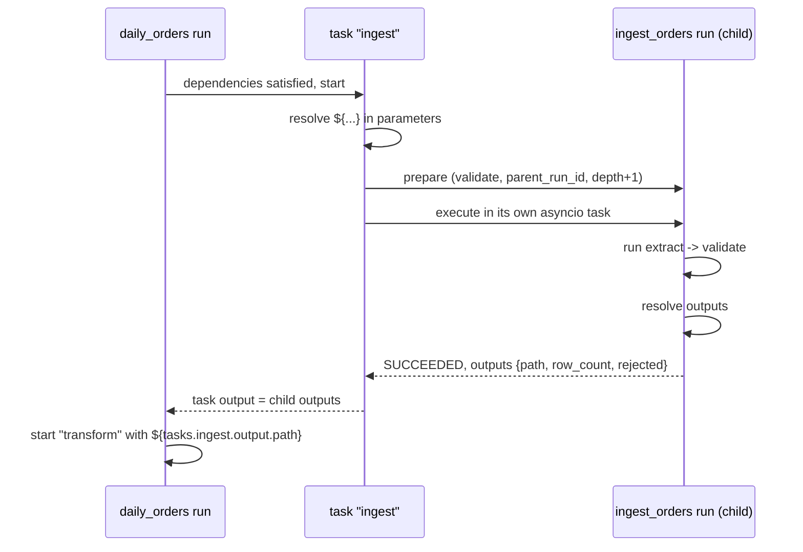
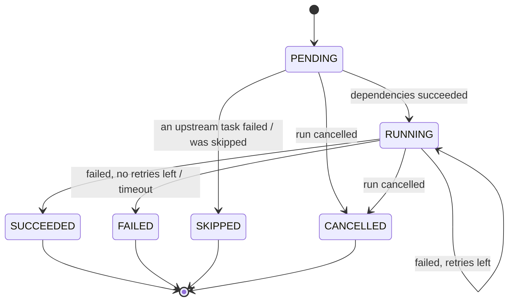

# Pipelines

A pipeline is a set of **tasks** connected by dependencies (a DAG). A task can
run Python code, run a shell command, or call **another pipeline** as a
sub-pipeline. Pipelines are YAML files in a project's `pipelines/` folder; the
file name without `.yaml` is the pipeline **id**.

## Projects

Workspaces live in `workspaces/` (one folder each); the server runs pipelines
from the active one. A workspace holds **projects**: the workspace folder itself
(it has `pipelines/` and `src/`), plus each top-level folder in it with a
`pipelines/` folder (usually brought in with **Workspace → Import code**). A
project keeps the Python code its pipelines call in its own `src/`, and its
data in `data/`.

```text
workspaces/
  my-workspace/
    pipelines/daily.yaml         -> id "daily"
    src/jobs/orders.py           -> entrypoint jobs.orders:extract
    my-project/                  imported project
      pipelines/pipeline1.yaml   -> id "pipeline1"
      src/hello_jobs/hello.py    -> entrypoint hello_jobs.hello:run
```

* Pipeline ids must be unique across projects; a duplicate is a validation error.
* A pipeline can call a pipeline from another project by id.
* `python` tasks import code from their own project's `src/`; `shell` tasks run
  in the project folder.
* Anything a `python` task prints is captured as that task's log (its
  printout in the UI) and still written to the server's terminal.

## File format

```yaml
# <project>/pipelines/daily_orders.yaml  ->  id "daily_orders"
name: Daily orders                 # optional display name (defaults to the id)
description: Ingest and transform  # optional

parameters:                        # declared parameters and their defaults
  run_date: "2026-01-01"

tasks:
  - key: ingest                    # unique within the pipeline, identifier-like
    type: pipeline                 # python | shell | pipeline
    pipeline: ingest_orders        # id of the pipeline to call
    parameters:
      run_date: ${params.run_date}

  - key: transform
    type: pipeline
    pipeline: transform_orders
    depends_on: [ingest]           # runs after ingest succeeded
    parameters:
      input_path: ${tasks.ingest.output.path}

  - key: report
    type: shell
    depends_on: [transform]
    command: echo "revenue ${tasks.transform.output.total_revenue}"

outputs:                           # returned to a calling pipeline
  total_revenue: ${tasks.transform.output.total_revenue}

schedule:                          # optional: run on a cron schedule (see Schedules)
  cron: "0 6 * * *"
```

### Fields common to all tasks

| Field | Type | Default | Meaning |
|---|---|---|---|
| `key` | string | required | Unique task id. Letters, digits, `_`; must not start with a digit. |
| `type` | `python` \| `shell` \| `pipeline` | required | Task kind |
| `description` | string | | Shown in the graph |
| `depends_on` | list of keys | `[]` | Tasks that must succeed first |
| `retries` | int 0-10 | `0` | Extra attempts after a failure |
| `timeout_seconds` | number | none | Fail the attempt after this long |

### `python` task

```yaml
- key: extract
  type: python
  entrypoint: jobs.orders:extract     # module:function inside the project's src/
  parameters:                         # passed as keyword arguments
    source_file: data/orders.csv
```

```python
# <workspace>/src/jobs/orders.py
def extract(source_file: str, ctx) -> dict:
    ctx.log("reading")                       # appears in the task log
    path = ctx.workspace / source_file       # the project folder as a Path
    return {"path": "...", "row_count": 10}  # must be JSON-serializable
```

* `ctx` is optional; declare it to receive a `TaskContext` (`run_id`,
  `root_run_id`, `pipeline`, `task_key`, `attempt`, `workspace` (the project
  folder), `log()`).
* Plain functions run in a worker thread; `async def` functions run on the
  event loop.
* A module is re-imported when its file changes, so code edits apply to the
  next run without restarting the server.
* The return value becomes the task **output**.

### `shell` task

```yaml
- key: report
  type: shell
  command: ./scripts/report.sh ${params.run_date}
  env:
    TARGET: ${params.target}
```

Runs with `/bin/sh` and the project folder as working directory. Each output
line goes to the task log. A non-zero exit code fails the task. The output is
`{"exit_code": 0, "stdout": "<last 10 000 characters>"}`.

### `pipeline` task (sub-pipeline)

```yaml
- key: ingest
  type: pipeline
  pipeline: ingest_orders
  parameters:
    run_date: ${params.run_date}
```

* Starts a **child run** of `ingest_orders` with the given parameters, merged
  over the callee's defaults.
* The task succeeds when the child run succeeds. Its output is the child's
  `outputs` mapping.
* A child can call further pipelines (nesting depth is limited, 10 by default).
* Cancelling the parent cancels the child. Cancelling only the child fails the
  parent task.



## References: `${...}`

| Reference | Value |
|---|---|
| `${params.<name>}` | Parameter value for this run |
| `${tasks.<key>.output}` | Whole output of an upstream task |
| `${tasks.<key>.output.<field>.<0>...}` | A field, or a list index, inside that output |
| `${run.id}`, `${run.pipeline}` | Current run id / pipeline id |

* If a value is **exactly** one reference, it keeps its type (number, list,
  object). Inside a longer string it is inserted as text (objects as JSON).
* References are allowed in `parameters` (python and pipeline tasks), `command`
  and `env` (shell tasks) and in `outputs`.
* Other `${...}` text, such as shell variables like `${HOME}`, is left
  unchanged.

## Validation rules

Validation runs when the server lists or loads pipelines, before every run,
and when the UI's **Validate** or **Save** buttons are used.

**Per file**

1. Valid YAML, top level is a mapping, and the file name is a valid id
   (`[a-z0-9][a-z0-9_-]*`).
2. Schema: known fields only, required fields present, valid `type`, `entrypoint` format.
3. Task keys are unique, every `depends_on` exists, and the task graph has no cycle.
4. `${params.x}` names a declared parameter.
5. `${tasks.k.output}` names a task that is an **upstream dependency**
   (direct or indirect) of the task using it.

**Across the workspace**

6. Every called pipeline exists and is itself valid.
7. Parameters passed to a sub-pipeline are declared by that sub-pipeline.
8. No recursive calls: `a -> b -> a` and `a -> a` are rejected, with the
   cycle path in the error.

An invalid pipeline cannot be run. It is still listed so you can fix it.

## Run semantics



* Independent tasks run **concurrently**.
* A failure skips everything downstream of it, but independent branches still
  finish (like Databricks' default "all succeeded" rule).
* A run is `SUCCEEDED` only if every task succeeded and the `outputs` resolved.

## Schedules

A pipeline runs on a schedule when its YAML has a `schedule:` block (the
Trigger card on the pipeline's page writes it for you):

```yaml
schedule:
  cron: "*/15 * * * * *"   # every 15 seconds
  timezone: UTC            # optional, default UTC
  enabled: true            # false pauses it
```

`cron` takes the standard five fields, `minute hour day-of-month month
day-of-week`, or six with a leading **seconds** field for schedules finer than
a minute:

| Cron | Runs |
|---|---|
| `*/15 * * * * *` | every 15 seconds |
| `*/10 * * * * *` | every 10 seconds |
| `* * * * *` | every minute |
| `*/15 * * * *` | every 15 minutes |
| `30 2 * * *` | every day at 02:30 |
| `0 9 * * 1-5` | weekdays at 09:00 |

The server checks schedules every second. A due run is skipped (not queued) if
the previous run of the pipeline is still going, and times missed while the
server was down are not run afterwards.
