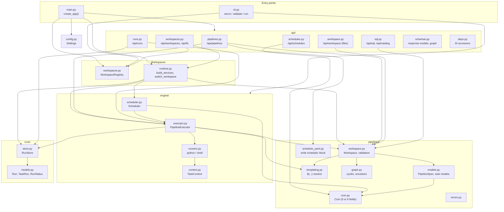
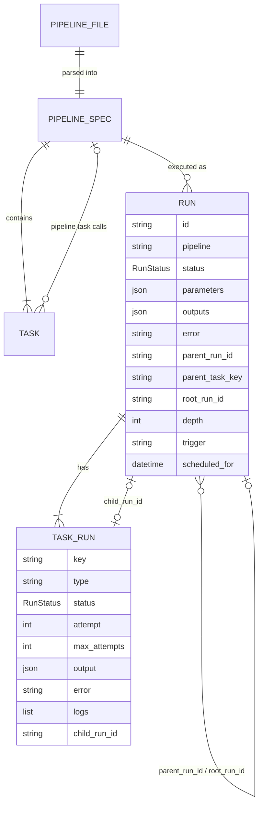
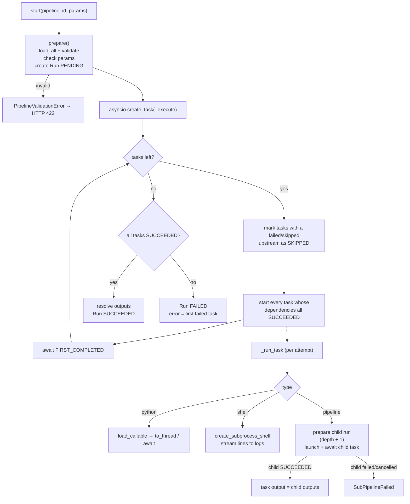
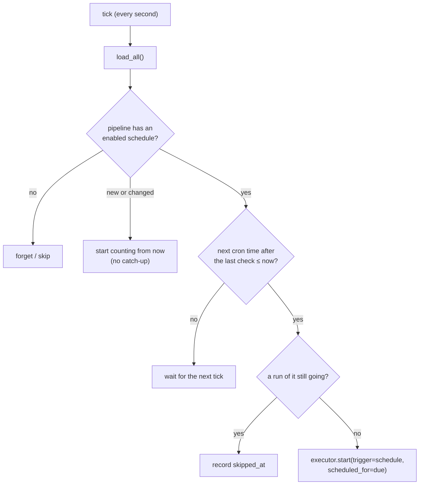

# Server

The server is the Python package `prooflix` in `server/`. It is built with
**FastAPI** and **Pydantic v2**, runs on **uvicorn**, and is managed with
**uv**. It needs Python 3.11 or newer.

## Package structure



| Module | Responsibility |
|---|---|
| `config.py` | `Settings` from environment variables: workspaces folder, default workspace, home folder, catalog folder, scheduler on/off, max nesting depth, CORS origins, client build folder |
| `main.py` | Builds the FastAPI app: makes the registry, builds the active workspace's services into `app.state`, starts/stops the scheduler with the app, serves `client/dist` when it exists |
| `workspaces.py` | `WorkspaceRegistry`: finds the workspaces in the workspaces folder, tracks added ones and the active one, saved to `<PROOFLIX_HOME>/workspaces.json` |
| `runtime.py` | `build_services()` makes `Workspace`, `RunStore`, `PipelineExecutor` and `Scheduler` for a workspace; `switch_workspace()` swaps them in `app.state` (refused while runs are going) |
| `cli.py` | `prooflix serve`, `prooflix validate`, `prooflix run <id> -p key=value` |
| `pipelines/models.py` | Pydantic models of the YAML format. Task types are a discriminated union on `type`; `schedule:` is validated with `Cron`. |
| `pipelines/workspace.py` | Lists projects and YAML files, runs per-file and whole-workspace validation, saves and deletes files (atomic writes) |
| `pipelines/templating.py` | Finds and resolves `${params...}`, `${tasks...}` and `${run...}` references |
| `pipelines/graph.py` | Cycle detection, transitive dependencies, shortest path (used to report recursive calls) |
| `pipelines/cron.py` | Parses cron expressions (5 fields, or 6 with seconds first) and computes the next times in a time zone, DST-aware |
| `pipelines/schedule_yaml.py` | Adds, replaces or removes a pipeline's `schedule:` block while keeping the rest of the file and its comments |
| `engine/executor.py` | Creates runs, schedules task DAGs, runs sub-pipelines as child runs, handles retries, timeouts and cancellation |
| `engine/runners.py` | Executes `python` (import + call, printout captured) and `shell` (subprocess) tasks |
| `engine/scheduler.py` | Starts runs on their cron schedules: ticks every second, no catch-up, no overlap |
| `api/sql.py` | Catalog listing, SQL queries, import and export over the data lake with DuckDB |
| `api/workspace.py` | The active workspace's files: tree, file content, import of uploaded folders, removal to trash |
| `api/workspaces.py` | Create, list, activate and forget workspaces; list server folders for the folder picker |
| `runs/models.py` | `Run`, `TaskRun`, `RunStatus` |
| `runs/store.py` | Thread-safe in-memory run index mirrored to `<workspace>/.prooflix/runs/<id>.json` |

## Data model



* A top-level run has `parent_run_id = null` and `root_run_id = id`.
* A child run created by task `ingest` of run `R` has
  `parent_run_id = R`, `parent_task_key = "ingest"`, the same `root_run_id`
  as `R`, and `depth = R.depth + 1`. The parent task's `child_run_id` points
  to it.
* `GET /api/runs/{id}/tree` follows these links to return the whole hierarchy.
* `trigger` says what started a run: `manual` (the UI, API or CLI), `schedule`
  (then `scheduled_for` holds the cron time it was due) or `pipeline` (a child
  run started by a parent's task).
* `TaskRun.logs` holds the task's log lines, including everything a Python task
  printed; the client shows them as the task's printout.

## Execution engine



### Concurrency

* All runs execute on the server's single asyncio event loop. Shell tasks are
  subprocesses; synchronous Python tasks run in the default thread pool;
  `async` Python tasks run on the loop.
* Each run, including each child run, is its own `asyncio.Task`, registered in
  `PipelineExecutor._active` so it can be cancelled by id.
* Run records are only mutated on the event loop. Log lines written from worker
  threads are handed to the loop with `call_soon_threadsafe`. API handlers are
  `async` so they read records on the same thread.

### Retries, timeouts, cancellation

| Situation | Behaviour |
|---|---|
| Task raises, retries left | Error is logged, `attempt` increases, task runs again |
| `timeout_seconds` exceeded | The attempt fails with "Timed out after Ns". A timed-out *thread* cannot be killed and finishes in the background; shell processes are killed. |
| Cancel a top-level run | Its asyncio task is cancelled. Running tasks and child runs become `CANCELLED`, and shell processes are killed. |
| Cancel a child run only | The child becomes `CANCELLED`. The parent task fails with "was cancelled" and its downstream tasks are skipped. |
| Server restarts mid-run | On startup `RunStore.recover_interrupted()` marks leftover `RUNNING`/`PENDING` runs as `FAILED`. |

## Scheduler

`engine/scheduler.py` runs inside the server and is started and stopped with
the app (and rebuilt when the active workspace changes). Every second it
reloads the pipelines and, for each valid pipeline with an enabled
`schedule:`, starts a run when the cron's next time after the last check has
passed.



* **No catch-up**: times missed while the server was down, or before a schedule
  was added or changed, are not run afterwards; only the latest due time runs.
* **No overlap**: a due run is skipped (and recorded as skipped) if the
  previous run of the pipeline is still going.
* Cron expressions have 5 fields (`minute hour day-of-month month
  day-of-week`) or 6 with seconds first (`*/15 * * * * *` is every 15 seconds),
  and are matched in the schedule's time zone.
* Scheduler state (last run, last skip, last error) is in memory and shown in
  each pipeline's `schedule` info; `PROOFLIX_SCHEDULER=0` turns it off.

## REST API

Interactive docs are at `http://127.0.0.1:8000/docs` while the server runs.

**Pipelines and runs**

| Method | Path | Body | Response |
|---|---|---|---|
| GET | `/api/health` | | `{status, version, workspace}` (the active workspace) |
| GET | `/api/pipelines` | | `PipelineSummary[]` (invalid ones included, with `errors`; `project`, `file` and `schedule` info) |
| GET | `/api/pipelines/{id}` | | `PipelineDetail`: summary + `source`, `spec`, `graph{nodes,edges}`, `used_by` |
| POST | `/api/pipelines/{id}/validate` | `{source}` | `{valid, errors}`. Validates unsaved YAML against the rest of the workspace. |
| PUT | `/api/pipelines/{id}[?create_only=true]` | `{source}` | `201`/`200 PipelineDetail`, `422 {detail:{errors}}`, `409` if `create_only` and it exists |
| DELETE | `/api/pipelines/{id}` | | `204`, or `409` when other pipelines call it |
| PUT | `/api/pipelines/{id}/schedule` | `{cron, timezone, enabled}` | `PipelineDetail`; writes the `schedule:` block into the YAML. `422` for an invalid cron or time zone. |
| DELETE | `/api/pipelines/{id}/schedule` | | `PipelineDetail` without a schedule (runs only when started) |
| GET | `/api/pipelines/{id}/tasks/{key}/code` | | `{type, language, path, content, line}`: the Python module (at the function), shell command or sub-pipeline YAML a task runs |
| POST | `/api/pipelines/{id}/runs` | `{parameters}` | `202 Run`, `404`, `422` (invalid pipeline or unknown parameters) |
| POST | `/api/schedules/preview` | `{cron, timezone}` | `{valid, cron, next_runs[5], error}`: checks a cron without saving |
| GET | `/api/runs?pipeline=&root_only=true&limit=50` | | `Run[]`, newest first |
| GET | `/api/runs/{id}` | | `Run` |
| GET | `/api/runs/{id}/tree` | | `Run` + `children: RunTree[]` (recursive) |
| POST | `/api/runs/{id}/cancel` | | `Run`, or `409` if already finished |

**Workspace files** (in the active workspace)

| Method | Path | Body | Response |
|---|---|---|---|
| GET | `/api/workspace/tree` | | The folder tree (hidden folders like `.prooflix` left out) |
| GET | `/api/workspace/file?path=` | | `{path, size, content}` (first 1 MB; `binary: true` for binary files) |
| POST | `/api/workspace/import` | `{files: [{path, content_base64}], overwrite}` | `{written, pipelines}`; `409` with `conflicts` when files exist and `overwrite` is false |
| DELETE | `/api/workspace/item?path=` | | Moves a file or folder to `.prooflix/trash/<time>/` |

**Workspaces**

| Method | Path | Body | Response |
|---|---|---|---|
| GET | `/api/workspaces` | | `{active, root, workspaces: [{name, path, active, default, in_root, exists}]}` |
| POST | `/api/workspaces` | `{parent, name}` | `201` entry. Creates `<parent>/<name>/` with `pipelines/` and `src/`; does not make it active. `409` if it exists. |
| PUT | `/api/workspaces/active` | `{path}` | The list, with `path` active. `409` while runs are going. |
| DELETE | `/api/workspaces?path=` | | The list without `path` (its folder is kept). `400` for the active or default workspace, or one in the workspaces folder. |
| GET | `/api/fs/dirs?path=` | | `{path, parent, dirs}`: sub-folders on the server, for the folder picker. Default: the workspaces folder. |

**SQL and catalog** (DuckDB over the Parquet files of the active workspace's `data/` folders and the catalog folder)

| Method | Path | Body | Response |
|---|---|---|---|
| GET | `/api/catalog` | | Schemas and their tables, with columns and row counts |
| GET | `/api/sql/tables` | | Every table with its SQL name (`qualified`), source file, row count and columns; used for completion |
| POST | `/api/sql/query` | `{sql, limit}` | `{columns, rows, row_count, truncated, elapsed_ms}`: one read-only `SELECT` |
| POST | `/api/catalog/import` | `{schema, files, overwrite}` | Adds CSV or JSON files as Parquet tables |
| GET | `/api/catalog/export?table=&schema=&format=` | | A table as CSV, or a ZIP (Parquet) of a table, a schema or the whole catalog |

### Workspaces

Workspaces live in the workspaces folder (`PROOFLIX_WORKSPACES`, default
`<repo>/workspaces`): every sub-folder with `pipelines/` is a workspace, listed
by name. Workspaces created or opened elsewhere are added to the list.

Exactly one workspace is active: pipelines, runs (in its own
`.prooflix/runs`) and schedules come from it. Until another is chosen it is the
default: `PROOFLIX_WORKSPACE` if set, otherwise the first workspace in the
folder; an empty folder gets a `default` workspace. The server saves the active
workspace at startup and on every switch, so a workspace created later that
sorts first doesn't take over; if the saved folder has gone it falls back to the
default.

Switching stops the scheduler, builds fresh services for the new folder and
starts the scheduler again, without a restart; it is refused while runs are
going. The catalog folder is shared by all workspaces (`catalog/` next to the
workspaces folder, or `PROOFLIX_CATALOG`). The CLI (`prooflix run`, `validate`)
uses the active workspace, or `--workspace`.

## Configuration

| Variable | Default | Meaning |
|---|---|---|
| `PROOFLIX_WORKSPACES` | `<repo>/workspaces` | Folder of workspaces |
| `PROOFLIX_WORKSPACE` | first workspace in the folder | Default workspace |
| `PROOFLIX_MAX_DEPTH` | `10` | Maximum sub-pipeline nesting depth |
| `PROOFLIX_CORS` | `http://localhost:5173,http://127.0.0.1:5173` | Allowed browser origins |
| `PROOFLIX_CATALOG` | `<workspaces>/../catalog` | Catalog folder for datasets outside projects |
| `PROOFLIX_SCHEDULER` | `1` | `0` stops pipelines running on their schedules |
| `PROOFLIX_HOME` | `~/.prooflix` | Server-wide state: the workspace list and the active workspace |

## Security note

Python and shell tasks run with the server's operating-system permissions,
and anyone who can reach the API can edit and run pipelines, list the
server's folders and create folders in them. The server binds
to `127.0.0.1` by default and has **no authentication** in this milestone. Do
not expose it on a network until authentication is added.

## Testing

```bash
cd server
uv run pytest
```

The suite covers templating, every validation rule, execution (sub-pipeline
output flow, failure propagation, retries, timeouts, cancellation in both
directions, depth limit, persistence and recovery), cron parsing and the
scheduler (including second-level schedules and DST), workspaces (creating,
switching, persistence, the workspaces folder), the SQL and catalog API, task
code, and the REST API end to end against a copy of the sample workspace in
`tests/fixtures/sample_workspace/`.
