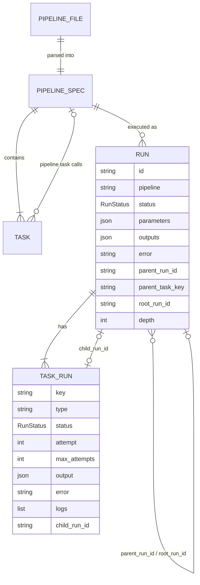
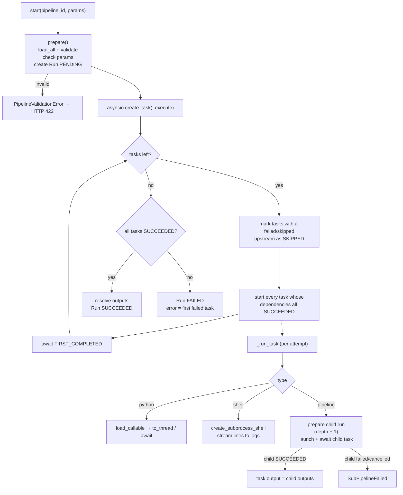

# Server

The server is the Python package `prooflix` in `server/`. It is built with
**FastAPI** and **Pydantic v2**, runs on **uvicorn**, and is managed with
**uv**. It needs Python 3.11 or newer.

## Package structure

```mermaid
flowchart TB
    subgraph entry["Entry points"]
        main["main.py<br/>create_app()"]
        cli["cli.py<br/>serve / validate / run"]
    end

    subgraph api["api/"]
        rp["pipelines.py<br/>/api/pipelines"]
        rr["runs.py<br/>/api/runs"]
        sch["schemas.py<br/>response models, graph"]
        deps["deps.py<br/>DI accessors"]
    end

    subgraph pipelines["pipelines/"]
        models["models.py<br/>PipelineSpec, task models"]
        wsp["workspace.py<br/>Workspace, validation"]
        tpl["templating.py<br/>${...} resolve"]
        graph["graph.py<br/>cycles, ancestors"]
        err["errors.py"]
    end

    subgraph engine["engine/"]
        exe["executor.py<br/>PipelineExecutor"]
        run["runners.py<br/>python / shell"]
        ctx["context.py<br/>TaskContext"]
    end

    subgraph runs["runs/"]
        rm["models.py<br/>Run, TaskRun, RunStatus"]
        rs["store.py<br/>RunStore"]
    end

    cfg["config.py<br/>Settings"]

    main --> api
    main --> cfg
    cli --> engine
    cli --> pipelines
    rp --> wsp
    rp --> exe
    rr --> rs
    rr --> exe
    exe --> wsp
    exe --> tpl
    exe --> run
    exe --> rs
    run --> ctx
    wsp --> models
    wsp --> graph
    wsp --> tpl
    rs --> rm
```

| Module | Responsibility |
|---|---|
| `config.py` | `Settings` from environment variables: workspace path, max nesting depth, CORS origins, client build folder |
| `main.py` | Builds the FastAPI app, wires the active workspace's services into `app.state`, serves `client/dist` when it exists |
| `workspaces.py` | `WorkspaceRegistry`: finds the workspaces in the workspaces folder, tracks added ones and the active one, saved to `<PROOFLIX_HOME>/workspaces.json` |
| `runtime.py` | Builds `Workspace`, `RunStore`, `PipelineExecutor` and `Scheduler` for a workspace, and swaps them in `app.state` when the active workspace changes |
| `cli.py` | `prooflix serve`, `prooflix validate`, `prooflix run <id> -p key=value` |
| `pipelines/models.py` | Pydantic models of the YAML format. Task types are a discriminated union on `type`. |
| `pipelines/workspace.py` | Lists and reads YAML files, runs per-file and whole-workspace validation, saves and deletes files (atomic writes) |
| `pipelines/templating.py` | Finds and resolves `${params...}`, `${tasks...}` and `${run...}` references |
| `pipelines/graph.py` | Cycle detection, transitive dependencies, shortest path (used to report recursive calls) |
| `engine/executor.py` | Creates runs, schedules task DAGs, runs sub-pipelines as child runs, handles retries, timeouts and cancellation |
| `engine/runners.py` | Executes `python` (import + call) and `shell` (subprocess) tasks |
| `runs/models.py` | `Run`, `TaskRun`, `RunStatus` |
| `runs/store.py` | Thread-safe in-memory run index mirrored to `<workspace>/.prooflix/runs/<id>.json` |

## Data model



* A top-level run has `parent_run_id = null` and `root_run_id = id`.
* A child run created by task `ingest` of run `R` has
  `parent_run_id = R`, `parent_task_key = "ingest"`, the same `root_run_id`
  as `R`, and `depth = R.depth + 1`. The parent task's `child_run_id` points
  to it.
* `GET /api/runs/{id}/tree` follows these links to return the whole hierarchy.

## Execution engine



### Concurrency

* All runs execute on the server's single asyncio event loop. Shell tasks are
  subprocesses; synchronous Python tasks run in the default thread pool;
  `async` Python tasks run on the loop.
* Each run, including each child run, is its own `asyncio.Task`, registered in
  `PipelineExecutor._active` so it can be cancelled by id.
* Run records are only mutated on the event loop. Log lines written from worker
  threads are handed to the loop with `call_soon_threadsafe`. API handlers are
  `async` so they read records on the same thread.

### Retries, timeouts, cancellation

| Situation | Behaviour |
|---|---|
| Task raises, retries left | Error is logged, `attempt` increases, task runs again |
| `timeout_seconds` exceeded | The attempt fails with "Timed out after Ns". A timed-out *thread* cannot be killed and finishes in the background; shell processes are killed. |
| Cancel a top-level run | Its asyncio task is cancelled. Running tasks and child runs become `CANCELLED`, and shell processes are killed. |
| Cancel a child run only | The child becomes `CANCELLED`. The parent task fails with "was cancelled" and its downstream tasks are skipped. |
| Server restarts mid-run | On startup `RunStore.recover_interrupted()` marks leftover `RUNNING`/`PENDING` runs as `FAILED`. |

## REST API

Interactive docs are at `http://127.0.0.1:8000/docs` while the server runs.

| Method | Path | Body | Response |
|---|---|---|---|
| GET | `/api/health` | | `{status, version, workspace}` |
| GET | `/api/pipelines` | | `PipelineSummary[]` (invalid ones included, with `errors`) |
| GET | `/api/pipelines/{id}` | | `PipelineDetail`: summary + `source`, `spec`, `graph{nodes,edges}`, `used_by` |
| POST | `/api/pipelines/{id}/validate` | `{source}` | `{valid, errors}`. Validates unsaved YAML against the rest of the workspace. |
| PUT | `/api/pipelines/{id}[?create_only=true]` | `{source}` | `201`/`200 PipelineDetail`, `422 {detail:{errors}}`, `409` if `create_only` and it exists |
| DELETE | `/api/pipelines/{id}` | | `204`, or `409` when other pipelines call it |
| POST | `/api/pipelines/{id}/runs` | `{parameters}` | `202 Run`, `404`, `422` (invalid pipeline or unknown parameters) |
| GET | `/api/runs?pipeline=&root_only=true&limit=50` | | `Run[]`, newest first |
| GET | `/api/runs/{id}` | | `Run` |
| GET | `/api/runs/{id}/tree` | | `Run` + `children: RunTree[]` (recursive) |
| POST | `/api/runs/{id}/cancel` | | `Run`, or `409` if already finished |
| GET | `/api/workspaces` | | `{active, workspaces: [{name, path, active, default, exists}]}` |
| POST | `/api/workspaces` | `{parent, name}` | `201` entry. Creates `<parent>/<name>/` with `pipelines/` and `src/`; does not make it active. `409` if it exists. |
| PUT | `/api/workspaces/active` | `{path}` | The list, with `path` active. `409` while runs are going. |
| DELETE | `/api/workspaces?path=` | | The list without `path` (its folder is kept). `400` for the active or default workspace. |
| GET | `/api/fs/dirs?path=` | | `{path, parent, dirs}`: sub-folders on the server, for the folder picker. Default: the workspaces folder. |

### Workspaces

Workspaces live in the workspaces folder (`PROOFLIX_WORKSPACES`, default
`<repo>/workspaces`): every sub-folder with `pipelines/` is a workspace, listed
by name. Workspaces created or opened elsewhere are added to the list.

Exactly one workspace is active: pipelines, runs (in its own
`.prooflix/runs`) and schedules come from it. Until another is chosen it is the
default: `PROOFLIX_WORKSPACE` if set, otherwise the first workspace in the
folder; an empty folder gets a `default` workspace. The server saves the active
workspace at startup and on every switch, so a workspace created later that
sorts first doesn't take over; if the saved folder has gone it falls back to the
default.

Switching stops the scheduler, builds fresh services for the new folder and
starts the scheduler again, without a restart; it is refused while runs are
going. The catalog folder is shared by all workspaces (`catalog/` next to the
workspaces folder, or `PROOFLIX_CATALOG`). The CLI (`prooflix run`, `validate`)
uses the active workspace, or `--workspace`.

## Configuration

| Variable | Default | Meaning |
|---|---|---|
| `PROOFLIX_WORKSPACES` | `<repo>/workspaces` | Folder of workspaces |
| `PROOFLIX_WORKSPACE` | first workspace in the folder | Default workspace |
| `PROOFLIX_MAX_DEPTH` | `10` | Maximum sub-pipeline nesting depth |
| `PROOFLIX_CORS` | `http://localhost:5173,http://127.0.0.1:5173` | Allowed browser origins |
| `PROOFLIX_CATALOG` | `<workspaces>/../catalog` | Catalog folder for datasets outside projects |
| `PROOFLIX_SCHEDULER` | `1` | `0` stops pipelines running on their schedules |
| `PROOFLIX_HOME` | `~/.prooflix` | Server-wide state: the workspace list and the active workspace |

## Security note

Python and shell tasks run with the server's operating-system permissions,
and anyone who can reach the API can edit and run pipelines, list the
server's folders and create folders in them. The server binds
to `127.0.0.1` by default and has **no authentication** in this milestone. Do
not expose it on a network until authentication is added.

## Testing

```bash
cd server
uv run pytest
```

The suite covers templating, every validation rule, execution (sub-pipeline
output flow, failure propagation, retries, timeouts, cancellation in both
directions, depth limit, persistence and recovery) and the REST API end to end
against a copy of the sample workspace.
