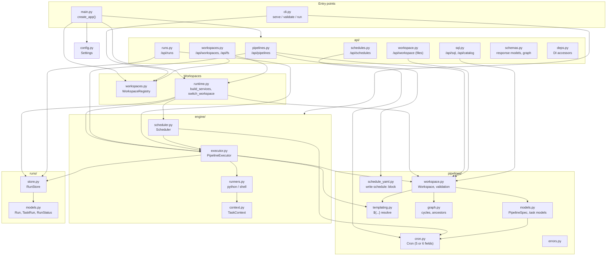
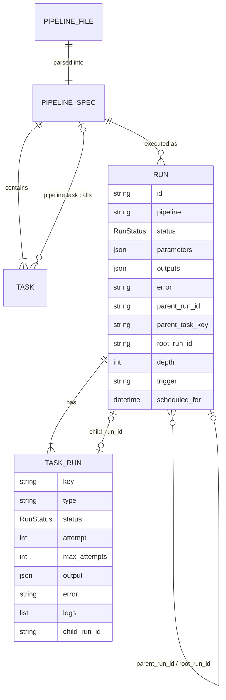
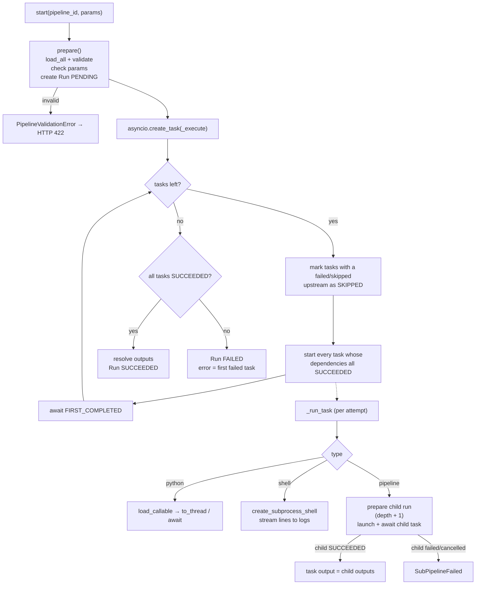
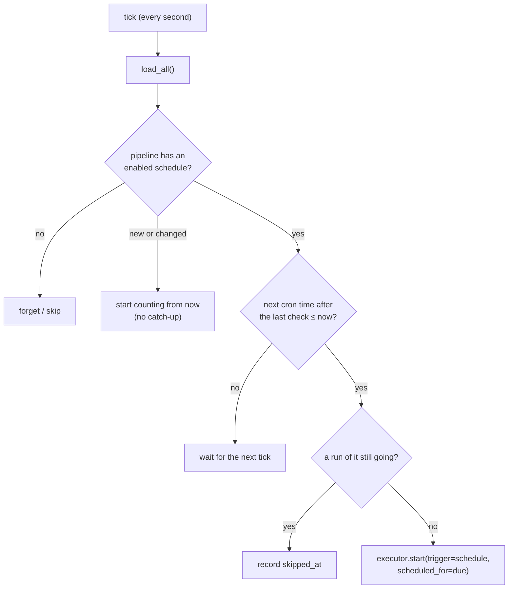

# Server

The server is the Python package `prooflix` in `products/ingestiq/server/`. It is built with
**FastAPI** and **Pydantic v2**, runs on **uvicorn**, and is managed with
**uv**. It needs Python 3.11 or newer.

## Package structure



| Module | Responsibility |
|---|---|
| `config.py` | `Settings` from environment variables and the values edited in the System tab (`<PROOFLIX_HOME>/parameters.json`, which win): workspaces folder, default workspace, home folder, catalog folder, scheduler on/off, max nesting depth, CORS origins, start date, linked folder defaults, client build folder |
| `main.py` | Builds the FastAPI app: makes the registry, builds the active workspace's services into `app.state`, starts/stops the scheduler with the app, serves the clients when built: the portal (`portal_dist`) at `/`, IngestIQ (`client_dist`) under `/ingestiq/`, InsightIQ (`insightiq_dist`) under `/insightiq/` and Settings & Management (`settings_dist`) under `/settings/`; old links to a tab (`/pipelines/...`, `/sql`, `/ingestiq/catalog`) redirect to the product that has it (`LEGACY_ROUTES`) |
| `linked_folders.py` | The source data (`source/`) and data lake (`data/`) folders per workspace (its setting, `PROOFLIX_SOURCE_DATA` / `PROOFLIX_DATA_LAKE`, or its own folder) and the links to them |
| `workspaces.py` | `WorkspaceRegistry`: finds the workspaces in the workspaces folder, tracks added ones and the active one, saved to `<PROOFLIX_HOME>/workspaces.json` |
| `runtime.py` | `build_services()` makes `Workspace`, `RunStore`, `PipelineExecutor` and `Scheduler` for a workspace; `switch_workspace()` swaps them in `app.state`; `restart()` reads the parameters again and rebuilds everything, for **Restart server** (both refused while runs are going) |
| `cli.py` | `prooflix serve`, `prooflix validate`, `prooflix run <id> -p key=value` (tasks get the saved database connections, `ctx.connection`, as in the server) |
| `pipelines/models.py` | Pydantic models of the YAML format. Task types are a discriminated union on `type`; `schedule:` is validated with `Cron`. |
| `pipelines/workspace.py` | Lists projects and YAML files, runs per-file and whole-workspace validation, saves and deletes files (atomic writes) |
| `pipelines/parameters.py` | `ParameterSpec` (a declared parameter: type, default, required, choices, pattern), the short-form/long-form parsing, and `bind()`, which converts and checks the values of every run before it starts |
| `pipelines/templating.py` | Finds and resolves `${params...}`, `${tasks...}`, `${run...}` and `${system...}` references |
| `pipelines/graph.py` | Cycle detection, transitive dependencies, shortest path (used to report recursive calls) |
| `pipelines/cron.py` | Parses cron expressions (5 fields, or 6 with seconds first) and computes the next times in a time zone, DST-aware |
| `pipelines/schedule_yaml.py` | Adds, replaces or removes a pipeline's `schedule:` block while keeping the rest of the file and its comments |
| `engine/executor.py` | Creates runs, schedules task DAGs, runs sub-pipelines as child runs, handles retries, timeouts and cancellation |
| `engine/runners.py` | Executes `python` (import + call, printout captured) and `shell` (subprocess) tasks |
| `engine/scheduler.py` | Starts runs on their cron schedules: ticks every second, no catch-up, no overlap |
| `api/sql.py` | Catalog listing, SQL queries, import and export over the data lake with DuckDB. Delta tables (a folder with `_delta_log`, at any depth under `data/`) are always one table each, read at their current version: the schema is their parent folder and the catalog the first folder in `data/` (`data/tenant1/lakehouse/bronze/accounts` is `tenant1.bronze.accounts`, as Spark registers it in Unity Catalog). When the data lake folder points inside a catalog (`PROOFLIX_DATA_LAKE=…/tenant1/lakehouse`), the catalog is the folder above it, so the names stay the same; only folder names are read there |
| `clickhouse.py` | Copies a catalog table into ClickHouse over its HTTP interface: maps the columns to ClickHouse types (`Int64`, `Float64`, `String`, `Date32`, `DateTime64(6, 'UTC')`, ..., each `Nullable`), loads the rows as Parquet into a staging table and swaps it in (`EXCHANGE TABLES`) |
| `auth.py` | Users (`PROOFLIX_HOME/users.json`, scrypt hashes), the password rules, signed session cookies, the lockout after wrong passwords, and which API paths each tab opens |
| `api/auth.py` | Sign in and out, the first admin, changing your password, and the Users tab's routes |
| `semantic.py` | The semantic model: entities (dimensions, measures, joins) and metrics, the `semantic/model.yaml` file, and the SQL a choice of measures and dimensions compiles to |
| `api/semantic.py` | The Semantic tab's routes |
| `ontology.py` | InsightIQ's ontology: object types (source table in any layer, row rules, properties, links) in `ontology/<type>.yaml` (drafts in `ontology/.drafts/`), the object view each read goes through, the wizard's checks, search and links |
| `ontology_store.py` | The object model's database (PostgreSQL, `PROOFLIX_DATABASE_URL`): numbered versions of published types, actions' edits (laid over objects when read, never written to the lake) and the audit log, per workspace; tables created on first use (`sqlite:///` works for tests) |
| `search_index.py` | Fast search: an OpenSearch index per type with `index: true` (`PROOFLIX_SEARCH_URL`): full builds into a new index swapped in by alias, updates of only the objects in the files a new Delta version added or removed (`delta_log.changes_since`), a watcher that checks the indexed tables every minute (with `PROOFLIX_SCHEDULER`), one job at a time (builds check their document count), state kept in OpenSearch (`prooflix-index-state`); when it starts, the watcher removes indexes of builds cut off by a stop |
| `object_sets.py` | Object sets: a type with filters, then links followed with filters of their own (at most 4 steps), compiled into one SELECT per step over the object views, with the viewer's access (no hidden types, no filters on sensitive properties they don't see) |
| `exports.py` | Background exports of a set to CSV or Parquet in `PROOFLIX_HOME/exports` (mode 600), edits laid over and masking applied, at most 5 million rows, one at a time, deleted after 24 hours |
| `link_pipelines.py` | The pipelines of computed links: one per link (`pipelines/object-link-<type>-<link>.yaml`), a Python task calling the platform task `prooflix.tasks.link_tables:build` on the link's schedule; written or removed when its type is published or unpublished |
| `api/ontology.py` | The Object Model and Objects tabs' routes, on one locked-down DuckDB per request (the SQL Editor's) |
| `alerts.py` | Alerts: message formats (`{field}` templates or regular expressions), channels (Email over SMTP, Slack, Teams, webhook) and rules in `PROOFLIX_HOME/alerts.json`, the engine that checks task log lines, cooldowns, delivery on background threads, and the history |
| `api/alerts.py` | The Alerts tab's routes |
| `connections.py` | Database connections (Oracle, SQL Server, MySQL, PostgreSQL): the fields of each type, the JDBC URL and driver, the store in `PROOFLIX_HOME/connections.json` (mode 600), and listing a database's tables and columns with pure-Python drivers (pg8000, PyMySQL, python-oracledb thin, python-tds) |
| `ingestion.py` | Ingestion jobs: a job (connection, tables, columns, watermarks, start date, schedule) as a generated pipeline calling the platform task `prooflix.tasks.jdbc_ingest:run`, and back (jobs calling the old `bronze.jdbc_ingest:run` still count) |
| `tasks/` | Platform tasks, generic Spark tasks shipped with Prooflix: `jdbc_ingest` (with `jdbc`, the JDBC helpers) and `link_tables`. Only `PLATFORM_TASKS` can be called; they use the workspace's Spark runtime (`workspace_runtime()`: `runtime.spark_session`, `runtime.catalog`, `infra.materialization`). The executor puts the project's `src/` first before calling one, and runs the old workspace entrypoints `bronze.jdbc_ingest:run` and `gold.link_tables:build` as the platform tasks unless the workspace has its own copy |
| `api/ingestion.py` | The Ingestion tab: connections (save, test, list tables) and jobs |
| `api/clickhouse.py` | The ClickHouse tab: connection status, the gold tables with their ClickHouse columns, and the import |
| `delta_log.py` | Replays a Delta table's `_delta_log` (newest checkpoint, then later commits) to list the Parquet files of its current version, so overwritten rows aren't read twice. Refuses deletion vectors and column mapping. |
| `api/workspace.py` | The active workspace's files: tree, file content, import of uploaded folders, removal to trash |
| `api/workspaces.py` | Create, list, activate and forget workspaces; list server folders for the folder picker |
| `api/system.py` | The system parameters: list them with their value, default and source, save an edited value (checked first), and restart in place |
| `runs/models.py` | `Run`, `TaskRun`, `RunStatus` |
| `runs/store.py` | Thread-safe in-memory run index mirrored to `<workspace>/.prooflix/runs/<id>.json` |

## Data model



* A top-level run has `parent_run_id = null` and `root_run_id = id`.
* A child run created by task `ingest` of run `R` has
  `parent_run_id = R`, `parent_task_key = "ingest"`, the same `root_run_id`
  as `R`, and `depth = R.depth + 1`. The parent task's `child_run_id` points
  to it.
* `GET /api/runs/{id}/tree` follows these links to return the whole hierarchy.
* `trigger` says what started a run: `manual` (the UI, API or CLI), `schedule`
  (then `scheduled_for` holds the cron time it was due) or `pipeline` (a child
  run started by a parent's task).
* `TaskRun.logs` holds the task's log lines, including everything a Python task
  printed; the client shows them as the task's printout.

## Execution engine



### Concurrency

* All runs execute on the server's single asyncio event loop. Shell tasks are
  subprocesses; synchronous Python tasks run in the default thread pool;
  `async` Python tasks run on the loop.
* Each run, including each child run, is its own `asyncio.Task`, registered in
  `PipelineExecutor._active` so it can be cancelled by id.
* Run records are only mutated on the event loop. Log lines written from worker
  threads are handed to the loop with `call_soon_threadsafe`. API handlers are
  `async` so they read records on the same thread.

### Retries, timeouts, cancellation

| Situation | Behaviour |
|---|---|
| Task raises, retries left | Error is logged, `attempt` increases, task runs again |
| `timeout_seconds` exceeded | The attempt fails with "Timed out after Ns". A timed-out *thread* cannot be killed and finishes in the background; shell processes are killed. |
| Cancel a top-level run (**Stop** in the client) | Its asyncio task is cancelled. Running tasks and child runs become `CANCELLED`, and shell processes are killed. A Python task's thread cannot be killed: its code runs on to the end in the background (and can still write files). |
| Cancel a child run only | The child becomes `CANCELLED`. The parent task fails with "was cancelled" and its downstream tasks are skipped. |
| Server restarts mid-run | On startup `RunStore.recover_interrupted()` marks leftover `RUNNING`/`PENDING` runs as `FAILED`. |

## Scheduler

`engine/scheduler.py` runs inside the server and is started and stopped with
the app (and rebuilt when the active workspace changes). Every second it
reloads the pipelines and, for each valid pipeline with an enabled
`schedule:`, starts a run when the cron's next time after the last check has
passed.



* **No catch-up**: times missed while the server was down, or before a schedule
  was added or changed, are not run afterwards; only the latest due time runs.
* **No overlap**: a due run is skipped (and recorded as skipped) if the
  previous run of the pipeline is still going.
* Cron expressions have 5 fields (`minute hour day-of-month month
  day-of-week`) or 6 with seconds first (`*/15 * * * * *` is every 15 seconds),
  and are matched in the schedule's time zone.
* Scheduler state (last run, last skip, last error) is in memory and shown in
  each pipeline's `schedule` info; `PROOFLIX_SCHEDULER=0` turns it off.

## REST API

Interactive docs are at `http://127.0.0.1:8000/docs` while the server runs.

**Pipelines and runs**

| Method | Path | Body | Response |
|---|---|---|---|
| GET | `/api/health` | | `{status, version, workspace}` (the active workspace) |
| GET | `/api/pipelines` | | `PipelineSummary[]` (invalid ones included, with `errors`; `project`, `file` and `schedule` info; `parameters`: the defaults, `parameter_specs`: each parameter's declaration) |
| GET | `/api/pipelines/{id}` | | `PipelineDetail`: summary + `source`, `spec`, `graph{nodes,edges}`, `used_by` |
| POST | `/api/pipelines/{id}/validate` | `{source}` | `{valid, errors}`. Validates unsaved YAML against the rest of the workspace. |
| PUT | `/api/pipelines/{id}[?create_only=true]` | `{source}` | `201`/`200 PipelineDetail`, `422 {detail:{errors}}`, `409` if `create_only` and it exists |
| DELETE | `/api/pipelines/{id}` | | `204`, or `409` when other pipelines call it |
| PUT | `/api/pipelines/{id}/schedule` | `{cron, timezone, enabled}` | `PipelineDetail`; writes the `schedule:` block into the YAML. `422` for an invalid cron or time zone. |
| DELETE | `/api/pipelines/{id}/schedule` | | `PipelineDetail` without a schedule (runs only when started) |
| GET | `/api/pipelines/{id}/tasks/{key}/code` | | `{type, language, path, content, line}`: the Python module (at the function), shell command or sub-pipeline YAML a task runs |
| POST | `/api/pipelines/{id}/runs` | `{parameters}` | `202 Run` (its `parameters` are the values used, defaults included), `404`, `422 {detail:{errors}}` (invalid pipeline, unknown parameters, or values that don't match their declaration: every problem listed) |
| POST | `/api/schedules/preview` | `{cron, timezone}` | `{valid, cron, next_runs[5], error}`: checks a cron without saving |
| GET | `/api/runs?pipeline=&root_only=true&limit=50` | | `Run[]`, newest first |
| GET | `/api/runs/{id}` | | `Run` |
| GET | `/api/runs/{id}/tree` | | `Run` + `children: RunTree[]` (recursive) |
| POST | `/api/runs/{id}/cancel` | | `Run`, or `409` if already finished |

**Workspace files** (in the active workspace)

| Method | Path | Body | Response |
|---|---|---|---|
| GET | `/api/workspace/tree` | | The folder tree (hidden folders like `.prooflix` left out) |
| GET | `/api/workspace/file?path=` | | `{path, size, content, modified}` (first 1 MB; `binary: true` for binary files) |
| PUT | `/api/workspace/file` | `{path, content, modified}` | Saves an existing text file (up to 1 MB) and returns it. `409` when the file changed since it was opened (`modified`), `404` for hidden or missing files, `413` too large, `422` binary; never reaches `PROOFLIX_HOME` |
| POST | `/api/workspace/import` | `{files: [{path, content_base64}], overwrite}` | `{written, pipelines}`; `409` with `conflicts` when files exist and `overwrite` is false |
| DELETE | `/api/workspace/item?path=` | | Moves a file or folder to `.prooflix/trash/<time>/` |
| GET | `/api/workspace/folders/{source-data,data-lake}` | | `{kind, link, path, origin, workspace_setting, server_default, linked}`: the folder `source/` or `data/` uses and whether it is the workspace's choice, the server default or its own folder |
| PUT | `/api/workspace/folders/{source-data,data-lake}` | `{path}` | Sets the active workspace's folder (`null`: back to the default); `source/` or `data/` becomes a link to it. `400` if it doesn't exist, is inside the workspace, or the workspace's own folder holds files |

**Workspaces**

| Method | Path | Body | Response |
|---|---|---|---|
| GET | `/api/workspaces` | | `{active, root, workspaces: [{name, path, active, default, in_root, exists, branch, is_copy}]}` (`branch`: the git branch checked out there; `is_copy`: a copy in `PROOFLIX_HOME/workspaces`); `active` is `null` while the list is empty |
| POST | `/api/workspaces` | `{parent, name}` | `201` entry. Creates `<parent>/<name>/` with `pipelines/` and `src/`; does not make it active unless the list was empty. `409` if it exists. |
| POST | `/api/workspaces/import` | `{name, files: [{path, content_base64}], activate}` | `201` `{workspace, written, pipelines}`. Creates `PROOFLIX_HOME/workspaces/<name>/` from the uploaded files (adding `pipelines/` and `src/` if missing) and makes it active unless `activate` is false. `409` if the folder exists. |
| POST | `/api/workspaces/find` | `{name, files}` | `[{path, matches, branch}]`: where a folder chosen in the browser is on the server (the browser never gives the path), to work on it in place. Searches breadth-first around the workspaces folder, the usual code folders and then the home folder, skipping hidden and data folders, for folders of that name with `pipelines/`; ranked by how many of the given files they hold, stopping at one that holds them all (4 seconds at most) |
| POST | `/api/workspaces/import-path` | `{path, mode, name, activate}` | `201` `{workspace, mode, source, copied_files, pipelines}`. Imports a project on the server from its exact path (it needs `pipelines/`): `mode: "in_place"` works on the folder where it is (in a git checkout, the branch checked out there), `"copy"` copies it into `PROOFLIX_HOME/workspaces/<name>` without `.git`, caches and virtualenvs (links such as `data/` stay links). `409` when the copy exists; `400` for a folder in, holding or above the server's private files |
| PUT | `/api/workspaces/active` | `{path}` | The list, with `path` active. `409` while runs are going. |
| DELETE | `/api/workspaces?path=` | | The list without `path`. Its folder is never touched; one in the workspaces folder is remembered as hidden. Removing the active workspace switches to another first (none if it was the last; `409` while runs are going). `400` for `PROOFLIX_WORKSPACE`. |
| GET | `/api/fs/dirs?path=` | | `{path, parent, dirs}`: sub-folders on the server, for the folder picker. Default: the workspaces folder. |

**ClickHouse** (gold tables copied for outside queries)

| Method | Path | Body | Response |
|---|---|---|---|
| GET | `/api/clickhouse/status` | | `{configured, reachable, url, public_url, reader, version, error, tables: [{database, name, rows, bytes}]}` |
| GET | `/api/clickhouse/gold-tables` | | `[{table, target, rows, columns: [{name, clickhouse_type}], error}]`: every table of a `gold` schema and the ClickHouse table it becomes (`tenant1.gold.x` -> `tenant1.x`) |
| POST | `/api/clickhouse/import` | `{tables: ["tenant1.gold.x", ...]}` | One result per table: `{table, target, ok, rows, columns, replaced, seconds, error}`. Each table is replaced as a whole; one failing leaves its old copy and doesn't stop the others. `409` when ClickHouse isn't configured. |

**Object Model** (InsightIQ's ontology; `/api/ontology` belongs to the `ontology` tab (shown as Object Model), `/api/ontology/objects` to `objects` or `ontology`; definitions are `ontology/<type>.yaml` in the active workspace, drafts `ontology/.drafts/<type>.yaml`)

| Method | Path | Body | Response |
|---|---|---|---|
| GET | `/api/ontology/sources` | | `[{table, layer, delta, rows, columns: [{name, type}]}]`: the catalog's tables in any layer (hidden schemas left out) |
| GET | `/api/ontology/types` | | `{types, drafts, broken}`: published types, drafts, and files that can't be read |
| GET, DELETE | `/api/ontology/types/{name}` | | `{type, modified, path}`; DELETE unpublishes (removes the file) |
| GET, PUT, DELETE | `/api/ontology/drafts/{name}` | PUT `{type, modified}` | `{type, modified}`. PUT is validated (`422` with the reasons, and when the name differs from the path); `409` when the draft changed since `modified` |
| POST | `/api/ontology/check` | `{type, steps?}` | `{ok, checks: [{step, name, status, severity, detail}], stats: {before, after, links}}`: the wizard's checks against the data (`status` ok, fail or info; `severity` block or warn) |
| POST | `/api/ontology/preview` | `{type, limit}` | `{sql, objects}`: sample objects through the draft's object view, masked for the user |
| POST | `/api/ontology/publish` | `{type, modified}` | Runs every check on the whole table; `422` with the blocking ones, `409` when the published type changed since `modified` (or exists and `modified` is null); else writes the file, drops the draft and answers `{type, modified, path, checks}` |
| GET | `/api/ontology/objects/types` | | The published types, each with `all_links` (its own and the reverse ones) |
| GET | `/api/ontology/objects/search?q=&type=&limit=&offset=` | | `{groups: [{type, objects, more, error}]}`: objects whose key or searchable (not sensitive) properties contain `q` |
| GET | `/api/ontology/objects/{type}/{pk}` | | `{object, layer, table, links: [{name, target, count, ...}]}` |
| GET | `/api/ontology/objects/{type}/{pk}/links/{link}?limit=` | | `{link, layer, objects, more}` |
| POST | `/api/ontology/objects/{type}/{pk}/actions/{action}` | `{values, reason}` | Applies an action: checks the user may run it, the reason, required values, choices and types; records the edits and an audit entry; answers `{object}` with the edit laid over. `403` not allowed, `409` without the database |
| GET | `/api/ontology/objects/{type}/{pk}/history` | | `{available, error, runs: [{run, action, reason, by, at, values}]}`: the actions applied to the object, newest first |
| GET | `/api/ontology/objects/status` | | `{database: {configured, ok, kind, error}, admin}` |
| GET | `/api/ontology/principals` | | The roles and users access rules can name: `[{principal, label, role}]` |
| GET | `/api/ontology/types/{name}/versions` | | `[{version, by, at}]` (needs the database) |
| GET | `/api/ontology/index` | | `{configured, ok, error, types: {name: {enabled, ready, stale, state: {docs, built, updated, fingerprint}, job}}}`: each type's fast-search index and its current job (`job.state` queued, running, done, failed, cancelled; `done`/`total` for progress) |
| POST | `/api/ontology/index/{name}/rebuild` | | Rebuilds the index from the whole table (a new index, swapped in when complete); `409` when Fast search is off or OpenSearch isn't set |
| POST | `/api/ontology/index/{name}/cancel` | | `{cancelled}`: stops the running job (a half-built index is deleted; the watcher doesn't restart it until Rebuild or a publish) |
| POST | `/api/ontology/index/rebuild` | | `{queued}`: rebuilds the index of every type with Fast search on, one after another |
| POST | `/api/ontology/sets/run` | `{set, limit, offset}` | `{steps: [{type, link, count}], objects, more, sql}`: each step's count and a page of the last step's objects; `422` for a type, link or property the viewer can't use, `409` when a link table isn't built yet |
| GET, POST | `/api/ontology/sets` | POST `{name, description, shared, set}` | The user's own sets and the shared ones (`{available, sets}`); POST saves a new one (needs the database) |
| PUT, DELETE | `/api/ontology/sets/{id}` | PUT as POST | Only its owner or an admin; a private set of someone else answers `404` |
| POST | `/api/ontology/exports` | `{set, format, name}` | Starts an export of the set's last step (`csv` or `parquet`): `{id, state, rows, total, ...}` |
| GET | `/api/ontology/exports` | | The user's exports (all for admins), newest first; older than 24 hours are deleted |
| GET, DELETE | `/api/ontology/exports/{id}/file`, `/api/ontology/exports/{id}` | | Download (its owner or an admin) / delete |
| GET | `/api/ontology/objects/suggest?q=&limit=` | | Autocomplete from the indexed types the user sees: `[{type, pk, title}]` |
| GET | `/api/ontology/audit?event=&type=&user=&limit=` | | The audit log, newest first: `[{id, at, user, event, type, pk, detail}]`; events `publish`, `unpublish`, `action`, `read_sensitive`, `view_as`. Admins only while users are on |

Each type's `access` (`view`, `sensitive`: `role:admin`, `role:user`, `user:<name>`) says who sees it
(empty: everyone with the Objects tab) and its sensitive properties (besides admins); a type the user
may not see is left out everywhere (types, search, links) and answers `404`. Each action's `allowed`
says who may run it (empty: admins only). Links are stored as a property on each side, as a link table your pipelines build (`storage: table`, `table`, `from_column`, `to_column`; many-to-many allowed) or computed (`storage: computed`, `sql`, `schedule`): publishing writes its pipeline, which builds `<catalog>.gold.link_<type>_<link>` with Spark; publishing a new or changed computed link needs an admin while users are on (its SQL runs on Spark, principle 14). `/api/ontology/sets` and `/api/ontology/exports` belong to the `objects` or `ontology` tab. Search uses a type's index when it is built for its current definition (each group says `engine`: `index` or `lake`, with a `note` when the index couldn't be reached and the lake was searched); the index holds no sensitive properties, and results get access, masking and edits as any read. `/api/ontology/preview` takes `as_user` (*View as user*:
never more than the caller sees). Publishing records a version (`version` in the answer) when the
database is set.

Objects are `{type, pk, title, properties}`. Sensitive properties are `••••` for everyone but admins
while users are on. Row filters are one expression on the table's own columns (no `;`, comments,
`SELECT`, `FROM` or table functions); every query is one read-only SELECT on the SQL Editor's
locked-down DuckDB, stopped after 30 seconds.

**Semantic model** (the Semantic tab; the model is `semantic/model.yaml` in the active workspace)

| Method | Path | Body | Response |
|---|---|---|---|
| GET | `/api/semantic` | | `{path, exists, modified, model}`: the saved model (an empty one when there is no file) |
| PUT | `/api/semantic` | `{model, modified}` | Saves the model (validated: names, unique entities and fields, joins to existing entities, metrics that use real measures). `409` when it changed since `modified`, `422` with the reasons when invalid |
| GET | `/api/semantic/yaml` | | `{path, text, modified}`: the file as written, for editing by hand |
| POST | `/api/semantic/yaml/validate` | `{text}` | `{ok, error, entities, metrics}` (nothing is saved) |
| PUT | `/api/semantic/yaml` | `{text, modified}` | Saves the text exactly as written once it is a valid model; `422` with the reason, `409` when the file changed since `modified` |
| GET | `/api/semantic/tables` | | `[{table, columns: [{name, type}]}]`: the catalog's tables, to choose from |
| POST | `/api/semantic/check` | `{model}` | `{ok, problems: [{where, problem}]}`: each table, column, expression, key, join and metric run with no rows |
| POST | `/api/semantic/query` | `{measures, dimensions, limit, model}` | `{sql, result}`: the SELECT the model writes (following joins between entities) and its rows; `model` is a draft, or the saved model when left out |

**Alerts** (the Alerts tab; admins and users given the `alerts` tab)

| Method | Path | Body | Response |
|---|---|---|---|
| GET | `/api/alerts/kinds` | | Channel types (`email`, `slack`, `teams`, `webhook`) with their fields, and the severities |
| GET | `/api/alerts/channels` | | `[{id, kind, name, config}]`; secrets (`url`, `password`, `authorization`) are `********` |
| PUT | `/api/alerts/channels/{id}` | `{kind, name, config}` | The channel; `********` keeps a saved secret. Slack URLs must be `https://hooks.slack.com/…`, Teams `https://…` |
| DELETE | `/api/alerts/channels/{id}` | | `204`; `409` while a rule names it |
| POST | `/api/alerts/channels/{id}/test` | | `{ok, error}` after sending a test alert (errors never show the secret) |
| GET / POST | `/api/alerts/rules` | `{name, enabled, mode, pattern, severity, pipelines, channels, cooldown_seconds}` | Rules; `mode` is `format` (text with `{fields}`) or `regex`; empty `pipelines` / `channels` mean all |
| PUT / DELETE | `/api/alerts/rules/{id}` | as above | The rule / `204` |
| POST | `/api/alerts/try` | `{mode, pattern, line}` | `{matches, fields}` (nothing is sent) |
| GET | `/api/alerts/history` | | The last 200 alerts, newest first, with each channel's delivery `status` (`sending`, `sent`, `failed`) and error |
| POST | `/api/alerts/history/delete` | `{ids}` | `{deleted}`: removes those alerts from the history (`ids: null` removes all) |

Every task log line is checked against the enabled rules as it is written (`TaskRun.log` → `AlertEngine.handle`), except the `$ command` line shell tasks echo. Deliveries run on background threads with a 10 second timeout, so they never slow a run. `alerts.json` fails closed like the other `PROOFLIX_HOME` files.

**Sign-in and users** (with `PROOFLIX_AUTH` on, every other `/api` route answers `401` without a session and `403` for a tab the user doesn't have)

| Method | Path | Body | Response |
|---|---|---|---|
| GET | `/api/auth/status` | | `{enabled, setup_needed, user, tabs, products}`: whether sign-in is on, whether the first admin is still to be created, the signed-in user (`{username, role, tabs, visible_tabs, visible_products, disabled, created_at, last_login}`), and the products the server serves (`PRODUCT_TABS` in `auth.py`). A user can open a product when they have one of its tabs |
| POST | `/api/auth/setup` | `{username, password}` | Creates the first admin and signs in; `409` once a user exists |
| POST | `/api/auth/login` | `{username, password}` | Sets the session cookie (HttpOnly, SameSite=Lax, Secure behind TLS, 12 hours); `401` for a wrong password or a disabled account, `429` with `Retry-After` after 5 wrong passwords (locked for a minute). `500` when `users.json` exists but can't be read: the server fails closed |
| POST | `/api/auth/logout` | | `204`, cookie removed |
| POST | `/api/auth/password` | `{current, new}` | Changes your own password; other sessions end |
| GET | `/api/users` | | Every user (admins only) |
| POST | `/api/users` | `{username, password, role, tabs}` | `201` the user; `422` when the password lacks 8 characters, a capital letter or a number |
| PUT | `/api/users/{name}` | `{role, tabs, password, disabled}` | The user; a new password or disabling ends their sessions. The last admin can't be demoted, disabled or deleted, nor can you disable or delete yourself |
| DELETE | `/api/users/{name}` | | `204` |

Each API path belongs to the tabs that use it (`TAB_PATHS` in `auth.py`): for example `/api/sql` to the SQL Editor and the Catalog, `/api/runs` to Pipelines and Ingestion; a test fails when a new route belongs to none. Ingestion runs its jobs through `/api/ingestion/jobs/{id}/runs`, not `/api/pipelines`. Only admins can save a pipeline with a shell task (`403`), Python tasks may only call functions defined in the workspace's `src/`, and no workspace route or linked folder reaches `PROOFLIX_HOME`.

**Ingestion** (database connections and the jobs that copy their tables into bronze)

| Method | Path | Body | Response |
|---|---|---|---|
| GET | `/api/ingestion/kinds` | | `[{kind, label, fields: [{key, label, type, default, required, options, help}]}]`: the database types (`oracle`, `sqlserver`, `mysql`, `postgresql`) and the fields each one's connection form asks for |
| GET | `/api/ingestion/connections` | | `[{name, kind, host, port, database, user, password, options, jdbc_url}]`; `password` is `********` when set |
| PUT | `/api/ingestion/connections/{name}` | `{kind, host, port, database, user, password, options}` | The connection. `password: "********"` keeps the saved one; `options` holds `connect_by` (Oracle) or `encrypt` / `trust_server_certificate` (SQL Server) |
| DELETE | `/api/ingestion/connections/{name}` | | `204`; `409` while a job uses it |
| POST | `/api/ingestion/connections/{name}/test` | | `{ok, tables, error}` (the password is never in `error`) |
| GET | `/api/ingestion/connections/{name}/tables` | | `[{schema, name, columns: [{name, type, watermark}]}]`; `watermark` marks date, timestamp and integer columns. `502` when the database can't be reached |
| GET | `/api/ingestion/jobs` | | `{jobs: [{id, name, connection, start_date, tables, schedule, errors}], task_ready, task_module}` |
| PUT | `/api/ingestion/jobs/{id}[?create_only=true]` | `{name, connection, start_date, schedule, tables: [{source, target, columns, watermark}]}` | The job; writes `pipelines/<id>.yaml` (in the project that has the Spark runtime, `src/runtime/spark_session.py`). `409` when the id is another pipeline's |
| POST | `/api/ingestion/jobs/{id}/runs` | `{from_date, to_date}` | `202 Run`: a normal run with no dates, or one for the rows between two dates (`YYYY-MM-DD`, both included; leave one out for an open side). Each table with a date watermark copies that range and overwrites what bronze has of it: by key columns, else by replacing the range. A job saved before this existed is written again with the `from_date` / `to_date` parameters first. `422` for a backwards range |
| DELETE | `/api/ingestion/jobs/{id}` | | `204` (bronze tables and run history stay) |

The Ingestion tab runs jobs through `POST /api/ingestion/jobs/{id}/runs` (no dates: a normal run). Tables list `primary_key` (from the database) and job tables take `keys`: the columns that identify a row, so rows already in bronze are overwritten (Delta MERGE) instead of appended.

**System parameters** (see [Configuration](#configuration))

| Method | Path | Body | Response |
|---|---|---|---|
| GET | `/api/system/parameters` | | `[{name, value, default, source, description, editable, kind, saved, restart_needed, live}]`: `value` is what the server uses now, `source` is `saved`, `environment` or `default`, `kind` is `folder`, `date` or `text`, `saved` the edited value and `restart_needed` whether it differs from what is in use |
| PUT | `/api/system/parameters/{name}` | `{value}` | The list. Saves the value to `<PROOFLIX_HOME>/parameters.json` after checking it (`422` with the reason); `null` or `""` removes it. `400` for `PROOFLIX_HOME`, `409` without a home folder. |
| POST | `/api/system/restart` | | The list. Reads the parameters again and rebuilds the registry and every service, without stopping the process. `409` while runs are going. `PROOFLIX_CORS` still needs a process restart. |

**SQL and catalog** (DuckDB over the Parquet files of the active workspace's `data/` folders and the catalog folder)

| Method | Path | Body | Response |
|---|---|---|---|
| GET | `/api/catalog` | | Schemas and their tables, with columns and row counts |
| GET | `/api/sql/tables` | | Every table with its SQL name (`qualified`), source file, row count and columns; used for completion |
| POST | `/api/sql/query` | `{sql, limit}` | `{columns, rows, row_count, truncated, elapsed_ms}`: one read-only `SELECT` |
| POST | `/api/catalog/import` | `{schema, files, overwrite}` | Adds CSV or JSON files as Parquet tables |
| GET | `/api/catalog/export?table=&schema=&format=` | | A table as CSV, or a ZIP (Parquet) of a table, a schema or the whole catalog |
| DELETE | `/api/catalog/schemas/{schema}?mode=hide\|delete` | | Drops a schema. `hide`: the Catalog and the SQL Editor's table list stop showing it (its data stays and it can still be queried by name), saved in `<workspace>/.prooflix/catalog.json`. `delete`: permanently deletes the folder (or file) of each of its tables and the folders left empty; other files are kept and Unity Catalog is not touched. Streaming checkpoints are not deleted either (Prooflix doesn't know where a workspace keeps them), so a pipeline that streams from a deleted table fails until its checkpoint is removed. With `PROOFLIX_AUTH` on, `delete` is for admins only (403) |
| DELETE | `/api/catalog/catalogs/{catalog}?mode=hide\|delete` | | Drops every schema of a catalog (a tenant such as `tenant1`) the same way; `delete` also removes the folders left empty up to the data lake folder. Returns the schemas and the deleted tables (qualified) |
| GET | `/api/catalog/hidden` | | Names of the hidden schemas |
| DELETE | `/api/catalog/hidden/{schema}` | | Shows a hidden schema again (204; 404 if it isn't hidden) |

### AI Assist

Claude helps where something failed, and only after the user agrees. The Claude account (API key, model,
effort) is in `PROOFLIX_HOME/ai_assist.json` (mode 600); with no key saved, the server's `ANTHROPIC_API_KEY`
is used. The key never leaves the server: responses carry only its kind and last four characters.

| Method | Path | Body | Response |
|---|---|---|---|
| GET | `/api/ai-assist/status` | | `{ready, enabled, model}`, for any signed-in user |
| GET | `/api/ai-assist/settings` | | The settings without the key: `key_source`, `key_hint`, `key_prefix`, `key_saved_at`, and the models with their prices per million tokens (admins only) |
| PUT | `/api/ai-assist/settings` | `{enabled, model, effort, api_key, remove_key}` | The settings; an empty `api_key` keeps the saved one (admins only) |
| POST | `/api/ai-assist/settings/test` | | `{ok, model, display_name}`: the key can see the model; uses no tokens (admins only) |
| POST | `/api/ai-assist/sql/fix` | `{sql, error}` | `{diagnosis, explanation, fixed_sql, confidence, runnable, problem, model}`. Sends the query, the error and the catalog's table and column names (no rows); the fix is checked to be one read-only `SELECT` and is never run here (SQL Editor users) |
| POST | `/api/ai-assist/runs/{id}/explain` | | `{diagnosis, failed_task, steps, confidence, model}` for a failed run (`409` otherwise). Sends the run and its sub-runs: parameters, each task's status and error, and the last 40 lines each task printed, with values that look like passwords, tokens or keys masked. Nothing is changed or re-run (Pipelines and Ingestion users) |
| POST | `/api/ai-assist/ask` | `{question, page, error, turns: [{question, answer}]}` | `{answer, can_fix, open_screen, model}`: a question from the AI Assist panel on any screen. `can_fix` is true only when a setting change might fix the problem (the panel then offers Fix it); `open_screen` is a tab id to offer a button to, or `""`. Sends the screen's name, the error it shows (if any) and up to 20 earlier questions and answers, with values that look like secrets masked; no data, files or runs. Any signed-in user; `413` over 2,000 characters, `422` when empty |
| POST | `/api/ai-assist/fix` | `{page, error, turns}` | `{summary, changes: [{name, current, value, reason, live}], steps, model}`: System tab settings to change and steps to do by hand that would fix what a screen shows, for the user to review. Sends the screen's name, its error, the conversation and the editable parameters without secrets (secret parameters are never sent or changed). Nothing is saved: the client applies each change with `PUT /api/system/parameters/{name}`, then `POST /api/system/restart`. System tab users only (`403`); `422` when there is no error or conversation yet |
| POST | `/api/ai-assist/runs/{id}/fix` | `{explanation}` (optional) | `{summary, changes: [{path, reason, before, after, modified, problems}], model}`: changes to the workspace files behind a failed run that would fix it, for the user to review. Sends the run (masked), the YAML of each pipeline in it and the Python files its python tasks call; files that look like they hold secrets are left out. A changed pipeline's YAML is checked by the validator (`problems`). Nothing is saved: the client applies each change with `PUT /api/workspace/file` and its `modified`. Needs the Workspace tab when users are on (`403`); `422` when there are no files to change |
| POST | `/api/ai-assist/runs/{id}/ask` | `{question, explanation, turns: [{question, answer}]}` | `{answer, model}`: a question about a failed run, before or after `/explain` (`explanation` is optional). The run is sent again as for `/explain` (masked), then the explanation if given and up to 20 earlier questions and answers; values that look like secrets in the questions are masked too. A question is at most 2,000 characters (`413`); `422` when empty, `409` if the run didn't fail. Nothing is changed or re-run (Pipelines and Ingestion users) |

Claude's errors become readable ones: a rejected key (`400`), an account out of credit (`402`), the rate
limit (`429`), Claude unreachable (`502`), or AI Assist off or without a key (`409`).

### Workspaces

Workspaces live in the workspaces folder (`PROOFLIX_WORKSPACES`, default
`<repo>/workspaces`): every sub-folder with `pipelines/` is a workspace, listed
by name. Workspaces created or opened elsewhere are added to the list.

Exactly one workspace is active: pipelines, runs (in its own
`.prooflix/runs`) and schedules come from it. Until another is chosen it is the
default: `PROOFLIX_WORKSPACE` if set, otherwise the first workspace in the
folder; an empty folder gets a `default` workspace. The server saves the active
workspace at startup and on every switch, so a workspace created later that
sorts first doesn't take over; if the saved folder has gone it falls back to the
default.

Switching stops the scheduler, builds fresh services for the new folder and
starts the scheduler again, without a restart; it is refused while runs are
going. The catalog folder is shared by all workspaces (`catalog/` next to the
workspaces folder, or `PROOFLIX_CATALOG`). The CLI (`prooflix run`, `validate`)
uses the active workspace, or `--workspace`.

## Configuration

The server itself doesn't use Spark. Pipeline code can: the `spark` extra
(`uv sync --extra spark`) installs PySpark, and the image adds Java 17 and the
Spark packages (see [deployment.md](deployment.md)). The `PROOFLIX_SPARK_*` and
`PROOFLIX_UC_*` variables the Helm chart sets are read by that pipeline code,
not by the server.

Every setting is a **system parameter**: an environment variable read when the
server starts. The **System** tab lists them all with the value in use, the
default and where it comes from, and edits them:

* An edited value is checked (folders must exist, numbers must be in range and
  so on), then saved to `<PROOFLIX_HOME>/parameters.json`. It **wins over the
  environment variable**, including one set by Helm.
* It is used after a restart: **Restart server** in the System tab reads the
  parameters again and rebuilds every service without stopping the process
  (refused while runs are going), and so does a normal process restart. Until
  then the row shows the value it will switch to.
* Removing the edited value goes back to the environment variable, or the
  default.
* `PROOFLIX_HOME` is set with the environment variable only, since edited values
  are saved in it. `PROOFLIX_CORS` is applied only when the process itself
  restarts.

| Variable | Default | Meaning |
|---|---|---|
| `PROOFLIX_WORKSPACES` | `<repo>/workspaces` | Folder of workspaces: each sub-folder with `pipelines/` is a workspace |
| `PROOFLIX_WORKSPACE` | first workspace in the folder | Default workspace, used until another one is made active |
| `PROOFLIX_MAX_DEPTH` | `10` | Maximum sub-pipeline nesting depth (1 to 100) |
| `PROOFLIX_CORS` | `http://localhost:5173,http://127.0.0.1:5173` | Allowed browser origins, comma-separated |
| `PROOFLIX_CATALOG` | `<workspaces>/../catalog` | Catalog folder for datasets outside projects |
| `PROOFLIX_SCHEDULER` | `1` (on) | `0` / `off` stops pipelines running on their schedules |
| `PROOFLIX_AUTH` | `1` (on) | Users and sign-in: every `/api` call needs a signed-in user, who reaches only the APIs of their tabs. `0` turns it off. Environment variable only (the System tab shows it but can't change it) |
| `PROOFLIX_START_DATE` | unset (all data) | Where data processing starts when the system is initialized: a pipeline with no checkpoint yet processes data from this date on. ISO 8601 date (`2026-01-01`) or time, stored as UTC. Pipelines read it as `ctx.start_date`, `${system.start_date}` or, in shell tasks, `$PROOFLIX_START_DATE` (see [pipelines.md](pipelines.md#references-)) |
| `PROOFLIX_HOME` | `~/.prooflix` | Server-wide state: the workspace list, the active workspace (`workspaces.json`) and the edited parameters (`parameters.json`). Environment variable only. |
| `PROOFLIX_SOURCE_DATA` | unset | Default source data folder (raw files pipelines read): every workspace's `source/` links there, unless the workspace chose its own (`<workspace>/.prooflix/settings.json`) |
| `PROOFLIX_DATABASE_URL` | unset (actions, versions and audit off) | PostgreSQL of InsightIQ's object model, `postgresql://host:5432/db` (no user or password in it) |
| `PROOFLIX_DATABASE_USER` / `_PASSWORD` | none | Its user; the password is never shown in the System tab |
| `PROOFLIX_SEARCH_URL` | unset (search reads the lake) | OpenSearch of the object model's fast search, e.g. `http://localhost:9200` |
| `PROOFLIX_SEARCH_USER` / `_PASSWORD` | none | For an OpenSearch with its security on; the password is never shown |
| `PROOFLIX_CLICKHOUSE_URL` | unset (tab off) | ClickHouse HTTP endpoint gold tables are copied to |
| `PROOFLIX_CLICKHOUSE_USER` / `_PASSWORD` | `default` / none | The user Prooflix writes with; the password is never shown in the System tab |
| `PROOFLIX_CLICKHOUSE_PUBLIC_URL` / `_READER` | unset | The address and read-only user shown to people who query it from outside |
| `PROOFLIX_DATA_LAKE` | unset | Default data lake folder (bronze, gold, checkpoints; read by the catalog and SQL): every workspace's `data/` links there, unless the workspace chose its own |

## Security note

Python and shell tasks run with the server's operating-system permissions,
and anyone who can reach the API can edit and run pipelines, list the
server's folders and create folders in them. The server binds
to `127.0.0.1` by default and has **no authentication** in this milestone. Do
not expose it on a network until authentication is added.

## Testing

```bash
cd products/ingestiq/server
uv run pytest
```

The suite covers templating, every validation rule, execution (sub-pipeline
output flow, failure propagation, retries, timeouts, cancellation in both
directions, depth limit, persistence and recovery), cron parsing and the
scheduler (including second-level schedules and DST), workspaces (creating,
switching, persistence, the workspaces folder), the SQL and catalog API, task
code, and the REST API end to end against a copy of the sample workspace in
`tests/fixtures/sample_workspace/`.
